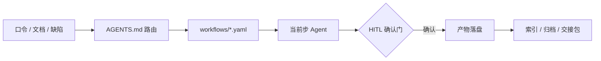

<div align="center">

# AI Workflow

**把产品 · 开发 · 测试，写成 AI 可执行的工作流。**

不靠聊天记忆，不靠口口相传——流程版本化在仓库里，口令即路由，确认门等人拍板，产物落在约定位置。

[](./LICENSE)
[](./CHANGELOG.md)
[](#三套独立包)
[](#三套独立包)
[](#架构)
[](#架构)
[](#仓库结构)
[](https://github.com/zhipenghhuang/AIWorkflow)
[](https://gitee.com/zhipenghhuang/AIWorkflow)

`YAML` · `Multi-Agent` · `Human-in-the-Loop` · `Agent Skills` · `MCP` · `Playwright`

[快速开始](#快速开始) · [常用口令](#常用口令) · [架构](#架构) · [FAQ](#faq) · [更新日志](./CHANGELOG.md)

</div>

---

## 这是什么

**AI Workflow** 是一套**规范模板仓库（母版）**：把产品、开发、测试三条协作轨，拆成 AI 可读可执行的包。

每个包都包含：流程定义 · 角色契约 · 规则红线 · 内置技能 · 可选能力 · 文档模板。  
复制一个包到项目根，挂上 `AGENTS.md` 入口——AI 就会按口令路由到对应流程，在确认门停下等你拍板，最后把产物写到约定位置。

> 本仓用于管理、发布与同步，**不充当业务执行现场**。落地时按角色复制单个包；三包互相独立，也可同项目多包装载并自动探测。

| | |
| --- | --- |
| **不是** | 提示词合集、聊天技巧手册、自研编排引擎 |
| **是** | 可版本化的工作流 + 角色契约 + HITL 确认门 + 完成门校验 + 文档治理 |

---

## 目录

- [为什么需要它](#为什么需要它)
- [核心亮点](#核心亮点)
- [三套独立包](#三套独立包)
- [快速开始](#快速开始)
- [常用口令](#常用口令)
- [架构](#架构)
- [确认门与质量闸](#确认门与质量闸)
- [仓库结构](#仓库结构)
- [设计原则](#设计原则)
- [自检](#自检)
- [适用场景](#适用场景)
- [FAQ](#faq)
- [文档导航](#文档导航)
- [反馈与贡献](#反馈与贡献)

---

## 为什么需要它

| 常见痛点 | AI Workflow 的做法 |
| --- | --- |
| 流程靠口口相传，换人、换会话就变样 | 流程写成 `workflows/*.yaml`，步骤 / 条件 / 门 / 产出可审查 |
| AI 一上来就写代码或文档，方向错了才返工 | 需求、PRD、方案、清单、提交、发布设 HITL 确认门，未确认不进入下一步 |
| 跨角色交接靠聊天，接收方不知道要做什么 | 默认自洽主文档；按需 `{HO-ID}` 标准包；正文须可独立执行；**未回执不得称已接收** |
| 每个项目都要重新解释一遍规范 | 整包复制即用；规则与实例分离，换项目只填档案 |
| 外部工具不一定装得齐 | 能力注册表：已安装即启用，未安装走降级，不阻塞 |
| 产物散落在聊天、桌面和项目根 | 文档治理：标准树、索引、归档、根目录白名单 |
| 规范越写越多，最后互相矛盾 | 单一出处；包自检检查引用、锚点、YAML 与版本单点 |

---

## 核心亮点

| 亮点 | 说明 |
| --- | --- |
| **声明式工作流** | `trigger → steps → agent`；条件步、确认门、质量闸都可审查 |
| **多 Agent 协作** | 角色契约按当前步加载；重阶段再读 playbook，避免塞满上下文 |
| **人工确认门** | 需求、PRD、方案、清单、提交、发布、回滚、验收、回写——该停就停 |
| **完成只认门** | Agent 只能提出候选完成；`验证/` 门读清单 / diff / 证据后才授予 `COMPLETE` / `PASS` / `READY` |
| **能力可插拔** | 外部工具已装即用，未装降级；技能随包生效，命中步必用；「体检能力」可按项目或通用最优就地优化 |
| **按风险裁剪** | 产品 P0～P3 · 开发 L0～L3 · 测试 T0～T3；低风险少文档，高风险才全链 |
| **宿主无关** | 任意支持 `AGENTS.md` 的 AI 编码工具即可；包内不写死宿主名 |



---

## 三套独立包

选一条轨即可上手；不必一次装全。

| 包 | 定位 | 工作流 | 技能 | 角色 | 上手 |
| --- | ---: | ---: | ---: | ---: | --- |
| **[产品规范](./产品规范/README.md)** | 0→1 与迭代：需求 · 竞品 · PRD · 原型 · UAT · 发布 | 11 | 15 | 8 | [说明](./产品规范/README.md) · [入口](./产品规范/AGENTS.md) |
| **[开发规范](./开发规范/README.md)** | 按 L0～L3 裁剪：澄清 → 实现 → 验证 → 提测 → 发布；内置轻量产品/测试轨 | 11 | 27 | 9 | [说明](./开发规范/README.md) · [入口](./开发规范/AGENTS.md) |
| **[测试规范](./测试规范/README.md)** | 计划驱动：分析 → 计划 → 生成 → 执行 → 报告 | 5 | 10 | 10 | [说明](./测试规范/README.md) · [入口](./测试规范/AGENTS.md) |

<details>
<summary><strong>产品规范 · 摘要</strong></summary>

- **边界**：只写需求、规则、原型、验收；技术架构 / 技术栈 / 数据库 / API / 部署留给开发轨。
- **主链**：`new-product` · `plan` · `prd` · `prototype` · `showcase` · `change` · `defect` · `deliver` · `handoff` · `onboard`（另含 `skill-audit`）
- **质量门**：G0～G6；PRD / 原型 / 计划 / UAT / 复盘 / 竞品分析·对标评分卡与追溯矩阵
- **产物**：统一落在 `产品/`（计划、需求池、竞品分析/对标、PRD、原型、UAT、GTM、交接包等）

</details>

<details>
<summary><strong>开发规范 · 摘要</strong></summary>

- **分级**：L0 微改走澄清 → 实现 → 验证 → 提交；L1 加轻量需求卡；L2 全链；L3 再加独立评审、安全 / 回滚演练、发布审批与观察。
- **轻量单人轨**：`solo`＝产品定义（按需）→ 一页方案卡 → 一次确认 → 实施 → 开发自验 → 完成门 → 收尾；轻量不降 AC/门/自验；档位拿不准先一问；L2+ 升级完整链。
- **主链**：`solo` · `control` · `intake` · `change` · `iterate` · `defect-fix` · `handoff` · `release` · `retro` · `onboard`（另含 `skill-audit`）
- **质量**：`engineering-quality` 统一工程质量条；完成门读 `.gate/开发规范/`
- **产物**：落在 `开发/`；根 `CHANGELOG.md`＝发版史；`开发/工作日志.md`＝岗位里程碑；`发布说明`＝按版本叙事

</details>

<details>
<summary><strong>测试规范 · 摘要</strong></summary>

- **编排载体**：`测试/测试计划.md` 为唯一版本级编排；正式轨并列功能 / 探索式 / 接口 / 发布前 / 缺陷。
- **主链**：`testing` · `defect` · `handoff` · `onboard`（另含 `skill-audit`）
- **执行**：R0 冒烟 → R1 正式 → R2+ 回归；稳定主链路优先 Playwright；**能脚本不 AI**
- **闸门**：覆盖三闸、冒烟前置、证据红线；P0 未通过不得判整体通过

</details>

<details>
<summary><strong>单包 / 多包 / 交接</strong></summary>

**单包优先**：复制哪个包，就只强制本包工作根（`产品/` 或 `开发/` 或 `测试/`）。另两目录**不要求**存在；多包联动可选、非必须，**不因缺他包阻塞本包**。

**版本记录三分法**：根 `CHANGELOG.md`＝仅开发维护（给人看的项目发版史，Keep a Changelog）；`产品/工作日志.md` · `开发/工作日志.md` · `测试/工作日志.md`＝各岗位里程碑侧记，**互不写入根**；年归档各自 `{包}/_归档/工作日志/工作日志-{year}.md`。计划执行日志＝细粒度过程；工作日志＝里程碑摘要；发布说明＝按版本叙事。

**原始资料根**：推荐 `docs/`（认根：用户指定优先，否则判定表，不定则问）。夹内一律原始资料、**不迁出**。中途存量全索引；按任务/版本按需复制或 R0～R2 吸收（可仅索引）。`keep`/`mix`/`replace` 只管原树结构，仍可复制/吸收。

**交接**：内容优先、包按需——默认自洽主文档（PRD/提测单/报告等），命中多文件/正式签收/仓外/点名才升 `{HO-ID}/` 标准包。同仓多包直读不转发；跨仓用文件夹 / ZIP。回执可选；**未收回执不得称「已接收」；可称「已发送」**。本侧收件走资料入站与理解吸收，HO 另可签收。

**发布门**：产品 `confirm_release`＝业务决策；开发 `confirm_deploy`＝工程部署。

</details>

---

## 快速开始

### 环境要求

| 依赖 | 用途 | 必需？ |
| --- | --- | --- |
| 支持 `AGENTS.md` 的 AI 编码工具（Cursor / Claude Code / opencode 等） | 执行宿主 | **必需** |
| PowerShell 5.1+ | 包自检 / 完成门 | 维护与过门时 |
| Python 3 + PyYAML | YAML schema、文档校验 | 可选（缺失则跳过并提示） |
| Node.js + Playwright | 测试脚本档 | 测试脚本轨可选 |
| 浏览器 MCP | UI 功能 / 探索式执行 | 按需 |
| Git | 提交门与版本管理 | 建议 |

### 1. 获取仓库

```bash
# 公开面（GitHub）：跑起来 / 阅读规范包所需内容
git clone https://github.com/zhipenghhuang/AIWorkflow.git
```

<!-- public:omit -->

> 协作全量在 Gitee（含 `.public/`、根 `AGENTS.md`、本机脚本等；不进公开树）。根 README 其余正文均可公开；协作专用说明只写在本 omit 段。

```bash
# 协作仓（Gitee 全量）
git clone https://gitee.com/zhipenghhuang/AIWorkflow.git
```

<!-- /public:omit -->

### 2. 只复制一个包到项目根

```bash
# macOS / Linux（以开发规范为例）
cp -r AIWorkflow/开发规范 /path/to/your-project/
```

```powershell
# Windows：排除运行态 / 缓存
robocopy "AIWorkflow\开发规范" "E:\path\to\your-project\开发规范" /E /XD .state .gate __pycache__
```

> 业务项目只需要**包 + 自己的文档目录**，不要把整个母版仓复制进去。产品 / 测试项目换成对应包名。
>
> **母版 / 实例边界**：母版只维护通用高标准。复制到项目后的规范包**默认不改**；AI 发现模板/规则/技能不匹配，先输出拟改内容/原因/影响，用户确认后只改当前实例，不影响母版。项目不匹配时优先改产出文档；通用改进回母版升版本。模板是骨架、标准是底线，按项目实际裁剪，不逐条硬凑。

### 3. 挂载项目根 `AGENTS.md`

已有则**追加**，不覆盖原文；没有则新建：

```markdown
# AGENTS.md

本项目启用 **开发规范** AI 工作流包。

1. 先读 `开发规范/AGENTS.md` **§0 硬节** → 命中口令行 → `workflows/*.yaml` **当前 step 块**；不要通读 §0～§3 全文或整本规则/技能/模板。
2. 本会话只启用开发规范（落地通常只装本包）。
3. 与本文冲突时以本文为准；细则以 `开发规范/AGENTS.md` 为准。
4. 文档按 `开发规范/规则/工作流.md` §5 落位；接入后先建 `文档索引.md`。
```

完整样例见各包 `规则/模板/00-接入与治理/根AGENTS薄指针.md`。

### 4. 让 AI 接入，然后开跑

```text
接入开发规范
```

```text
开发计划
```

也可以直接从任意入口进入：`轻量开发` · `写 PRD` · `生成测试计划` · `按方案实施` ……

---

## 常用口令

对 AI 说一句人话即可；命中后按 workflow 执行到产出或下一个确认门。

| 包 | 说一句 | 会发生什么 |
| --- | --- | --- |
| 产品 | 任意自然语言描述需求/反馈（不用口令） | 五元组入口判定 → 意图类路由（受理/洞察/0→1/…） |
| 产品 | `启动新产品：{一句话}` | 0→1 发现 → 立项 Go/Hold/Kill → 产品定义 |
| 产品 | `产品计划` / `写 PRD` / `画原型` | 计划门 · PRD 链路 · 原型与设计交接 |
| 产品 | `需求变更` / `UAT` / `发布` / `复盘` | 变更处置 · 验收 · 发布决策 · 复盘 |
| 开发 | 任意自然语言描述问题/需求（不用口令） | 五元组入口判定 → 意图类路由（solo/change/iterate/…） |
| 开发 | `我有个想法：…` / `轻量开发` / `轻量测试` | 一页方案卡 → 确认 → 实施 → AI 实测 → 收尾；L2+ 自动升级 |
| 开发 | `开发计划` / `下一步` / `当前状态` | 建 / 续跑开发计划，执行到下一个门 |
| 开发 | `按方案实施` / `代码评审` / `提测` | 落地实施 · 六轴评审 · 提测单与发布说明 |
| 开发 | `发布` / `回滚` / `复盘` | 上线检查与审批 · 按预案回滚 · 事实→根因→行动项 |
| 测试 | 任意自然语言描述要测/跑测/准出（不用口令） | 五元组入口判定 → 意图类路由；有计划按 §0 续跑 |
| 测试 | `生成测试计划` / `按测试计划执行` | 计划门确认 → 分轨执行 → 报告 |
| 测试 | `测试报告` / `提交缺陷` / `回归验证` | 准出评估 · 查重提交 · 回归与回写 |
| 三包 | `生成交接包` / `接收交接包` / `交接状态` | `{HO-ID}` 包 + 回执 + 台账 |
| 三包 | `发变更通知` / `同步变更` | `CHG` 包；按 C0～C3 重基线并回写计划 |
| 三包 | `装配能力` | 盘点并安装可选外部能力（安装向导） |
| 三包 | `体检能力` / `通用优化技能` | 检查外部能力 + 随包技能；确认后可就地改本包（通用模式不绑具体项目） |

更完整的口令表见各包 `AGENTS.md`（产品/开发 §3，测试 §2）。口语未命中时，三包均按各自 `规则/核心/入口判定.md` 做**通用意图判定**（五元组→意图类），不是口令同义词表。

---

## 架构

五步执行模型：

1. **路由** — 读包内 `AGENTS.md` **§0 硬节**；口令表仅路由未定/首次命中时读；命中 workflow；首条输出 `route=workflow:... | step=... | reads=...`；纯解释/对比/诊断走 `readonly:analysis`，不强行套 workflow（**禁止通读 §0～§3 全文**）
2. **加载** — 按读序：§0 → workflow **当前 step 块** → `规则/读取索引.md` 当前行 → 当前 agent → 命中技能/playbook 当前节；只读当前步，不预防性通读
3. **执行** — 步内方法由 AI 自主选择；条件步按 `when` 跳过；步上 `hitl` 必须停下确认；自主边界见 `规则/核心/执行契约.md`
4. **验证** — 运行包内 `验证/Invoke-Gate.ps1`；门读验收清单 / diff / 证据，写 `.gate/`；只有门能授予完成态
5. **落盘** — 按模板写入本包标准目录，更新索引 / 计划 / `activeContext.md`；收尾先写【验证回执】再写结论

九层结构：

| 层 | 作用 | 落点 |
| --- | --- | --- |
| Workflow | trigger → steps → agent；条件步与确认门 | `workflows/*.yaml` |
| Agent 契约 | 角色目标、边界、产出 | `agents/*.yaml` |
| 规则 / 门 / 读取索引 | 不变量、门语义、步骤级读取预算 | `规则/门.md` · `规则/读取索引.md` |
| 协作交接 | 交接矩阵、交接包 / 回执、C0～C3 变更 | `规则/协作/` + `workflows/handoff.yaml` |
| Stage playbook | 重阶段步骤卡 | `规则/playbooks/*.md` |
| 专业技能 | 每步方法，随包生效，命中步必用 | `技能/<name>/SKILL.md` |
| 能力层 | 外部工具建议：已装即用，未装降级 | `能力/00-能力注册表.md` |
| 验证层 | 检查矩阵、完成门（包内只读）；运行态落 `.gate/` | `验证/` |
| 文档治理 | 产物落位、索引、归档、根目录白名单 | `规则/文档治理.md` + `规则/模板/` |

执行宿主是任意支持 `AGENTS.md` 自动装载的 AI 编码工具，**不自研编排引擎**。

---

## 确认门与质量闸

确认门只认 workflow 步骤上的 `hitl`；条件不满足会自动跳过。开跑前先按各包 `规则/核心/澄清.md`：先分析，再给「我的理解 + 建议 + 需要你拍板（0～1 个）」；总提问 ≤3；禁把假设当结论。

| 包 | 关键确认门 |
| --- | --- |
| 产品 | 立项 · 计划 · 范围 · PRD · 设计 · 原型交接 · 变更 · 交接 · 回写 · 发布 · 提交 |
| 开发 | 计划 · 需求基线 · 方案 · 任务清单 · 交接 · 部署 · 回滚 · 验收 · 提交 |
| 开发（轻量 solo） | 产品定义（按需） · 方案卡 · 提交 |
| 测试 | 计划 · 执行范围 · 交接 · 提交 · 缺陷回写 |

| 闸 | 规则 |
| --- | --- |
| PRD 定稿 | 未定稿不排期；写不出验收标准 = 需求未定义完 |
| 方案评审 | 未批准不实施；破坏性变更须有兼容与回退思路 |
| 任务清单 | RP / AC / DoR / DoD 覆盖；确认后冻结 |
| 代码门禁 | 失败不声称完成；禁止改断言、跳测试、关告警凑绿 |
| 发布 | 上线检查单 + 审批 + 回滚预案 + 验证 |
| 测试准出 | P0 未过不得整体通过；证据可打开；缺口显式列出 |
| 交接 | 无清单 / 无版本 / 无回执模板不发；未回执不得称「已接收/已交接完成」；可称「已发送」 |

---

## 仓库结构

```text
AIWorkflow/
├─ 产品规范/          # 产品轨母版
├─ 开发规范/          # 开发轨母版（含轻量单人轨）
├─ 测试规范/          # 测试轨母版（5 workflow · 10 技能 · 10 角色）
├─ CHANGELOG.md       # 母版仓长期版本记录（最新在前）
├─ LICENSE            # MIT
└─ README.md
```

> workflow / 技能 / 角色与模板数量均以各包目录与自检为准；上表只作导航，不在多处维护计数。

每个包内部结构一致：

```text
{包}/
├─ AGENTS.md             # AI 入口：路由、不变量、读取协议（版本单点）
├─ README.md             # 给人看的上手说明
├─ workflows/*.yaml      # trigger → steps → agent / when / hitl
├─ agents/*.yaml         # 角色目标、边界、产出
├─ 技能/<name>/SKILL.md  # 随包生效，命中步必用
├─ 能力/00-能力注册表.md  # 外部工具：已装即用，未装降级
├─ 规则/
│  ├─ 读取索引.md · 门.md · 工作流.md · 文档治理.md
│  ├─ 核心/ · 协作/ · 缺陷/ · 专项/ · playbooks/
│  ├─ 模板/              # NN-组/ + 模板索引.md
│  └─ tools/             # 自检与校验脚本
└─ 验证/                 # 检查矩阵、完成门（只读）；运行态 → 项目根 .gate/
```

<details>
<summary><strong>文档落点（实例侧）</strong></summary>

各包只强制本包工作根（`产品/` / `开发/` / `测试/`）；未装的包不必建对应目录。原始资料根推荐 `docs/`（其它名可，记档案）；资料模式 keep/mix/replace 只整理原始资料根。项目根只保留白名单（含档案入口、`activeContext.md`、原始资料根等）。

| 类别 | 落点 |
| --- | --- |
| 开发轨治理 | `开发/00-项目治理/`：变更记录、待决项、决策记录、缺陷评估 |
| 开发轨基线 | `开发/01-需求基线/` · `开发/02-方案设计/` · `开发/03-技术设计/` |
| 开发轨计划/验收/发布/复盘 | `开发/04-计划与任务/` ～ `08-复盘与改进/` 标准组 |
| 产品版本目录 | `产品/{版本或主题}/`：`01-需求与定义`～`06-复盘`（按需建）；受理/变更/缺陷在 `03-变更与缺陷/` |
| 测试轨 | `测试/测试计划.md` · `测试/测试报告.md` · `测试/功能测试/` 等分轨目录 |
| 原始资料根 | 推荐 `docs/` + `资料索引.md`（单包/多包共用；其它名可登记；确认后复制进当前包 `资料/`） |
| 交接包 | `产品/交接/` · `开发/交接/` · `测试/交接/`（`{HO-ID}/`） |
| 索引入口 | `文档索引.md` · `开发计划.md` · `activeContext.md` |
| 长期版本记录 | `CHANGELOG.md` |
| 归档 | `_归档/{yyyyMMdd}-{版本}/` |

</details>

---

## 设计原则

- **框架固定，局部自主** — 口令映射、步上 `hitl`、输出骨架、证据与红线默认按规则；与用户指令冲突时先说明风险与替代，用户再次明确选择后以用户为准；收尾 `deviation=` 按实记取舍；步内怎么探查 / 改 / 验由 AI 自主。
- **做减法** — 界面先删无决策价值的标语 / 说明 / 副标题 / 次要标签；删后不清楚改布局，不加回说明。
- **三维同向** — 每次改动兼顾用户体验、开发体验与 AI Agent 体验；任一不得净退化。
- **完成只认门** — Agent 不能自证 `COMPLETE` / `PASS` / `READY`。
- **按风险分级** — 低风险只通知，高风险才审批；重阶段用 playbook，轻步骤留 YAML。
- **规则与实例分离** — 通用规范在包内；项目档案、基线、业务产物在实例侧。
- **技能随包，能力可选** — 技能给方法；能力给工具，缺失不阻塞；落地包可用「体检能力」就地改技能/能力（无需另有母版仓）。
- **单一出处，版本单点** — `template_version` 只写在各包 `AGENTS.md`；根 README 不缀版本号。
- **文档现行有效** — 只写当前存在的功能与规则；旧版归档，不堆「最终版 2」。
- **内容优先 · 包按需** — 默认自洽主文档；升包才 `{HO-ID}`；正式签收才须回执；变更按 C0～C3 重基线。
- **宿主无关** — 包内只写能力名，不写宿主名和本地路径。

---

## 自检

改包后或用户点名时运行；业务任务不例行自检，接入时由 onboarding 核验一次并打标。自检为本地/按需运行，不依赖 GitHub Actions。执行契约（自主边界/步骤契约/计划同步）见各包 `规则/核心/执行契约.md`；角色边界见 `规则/协作/角色契约.md`；外部方法来源见 `THIRD_PARTY.md`。

```powershell
powershell -ExecutionPolicy Bypass -File "产品规范/规则/tools/Test-Template.ps1"
powershell -ExecutionPolicy Bypass -File "开发规范/规则/tools/Test-Template.ps1"
powershell -ExecutionPolicy Bypass -File "测试规范/规则/tools/Invoke-TestWorkflow.ps1" -Action ValidateTemplateRefs
python 产品规范/规则/tools/check_skills.py 产品规范 --strict
python 开发规范/规则/tools/check_skills.py 开发规范 --strict
python 测试规范/规则/tools/check_skills.py 测试规范 --strict
powershell -ExecutionPolicy Bypass -File "产品规范/规则/tools/Test-DocHygiene.ps1"
powershell -ExecutionPolicy Bypass -File "开发规范/规则/tools/Test-DocHygiene.ps1"
powershell -ExecutionPolicy Bypass -File "测试规范/规则/tools/Test-DocHygiene.ps1"
```

完成门（业务任务收尾前，读当前项目产物）：

```powershell
powershell -ExecutionPolicy Bypass -File "开发规范/验证/Invoke-Gate.ps1" -ProjectRoot "."
powershell -ExecutionPolicy Bypass -File "测试规范/验证/Invoke-Gate.ps1" -Mode report -ProjectRoot "."
powershell -ExecutionPolicy Bypass -File "产品规范/验证/Invoke-Gate.ps1" -Mode prd -ProjectRoot "."
```

单项校验示例：

```bash
python 产品规范/规则/tools/validate_prd.py <PRD.md>
python 开发规范/规则/tools/validate_tasklist.py <任务清单.md>
python 开发规范/规则/tools/validate_dev_plan.py <开发计划.md>
python 测试规范/规则/tools/validate_testcase.py <模块用例.md>
python 测试规范/规则/tools/validate_api_testcase.py <接口域用例.md>
python 产品规范/规则/tools/validate_handoff.py <交接包目录>
```

---

## 适用场景

**适合**

- 想把 AI 协作从「聊天」变成可复用流程的产品 / 研发 / 测试团队
- 需要人工审批、证据链和文档留痕的项目
- 要在多个项目、多个宿主之间复用同一套规范
- 希望 AI 按变更大小自动裁剪流程，而不是每次全量走一遍

**不适合**

- 只想要一份提示词模板
- 无需流程与留痕的一次性脚本
- 希望 AI 完全自动、不要任何确认门的场景

---

## FAQ

**需要安装编排引擎吗？**  
不需要。执行器就是支持 `AGENTS.md` 的 AI 编码工具；YAML 是给 AI 读的流程定义，不是运行时依赖。

**三个包必须一起装吗？单包 / 多包 / 交接怎么理解？**  
不必。**默认单包独立落地**；多包可共用资料根与 `activeContext`，联动可选、非必须，不因缺他包阻塞。只强制本包工作根。版本记录：根 `CHANGELOG` 仅开发包维护；各岗位 `工作日志.md` 不写根。原始资料根（推荐 `docs/`）＝原始输入主副本；确认后复制进本包再吸收。交接：内容优先、包按需；同仓直读不转发；仓外文件夹/ZIP；未回执不得称「已接收」。

**没有 Python / Node.js 能跑吗？**  
能。工作流本身只依赖宿主；Python / Node / Playwright 缺失时走降级路径并提示一次。

**会不会强制写很多文档？**  
不会。开发轨 L0 不强制文档；L1 轻量；L2/L3 才走完整文档链。测试轨维护域常青分层库（L0/L1/L2），按计划装填执行（suite=core|module|full）；生成对命中域宁多勿漏，禁无分析全仓重生。

**支持哪些宿主？**  
任何支持 `AGENTS.md` 入口自动装载与文件读写 / 命令执行 / 对话确认的工具均可，例如 Cursor、Claude Code、opencode 等。包本身不绑定宿主。

**可以改成我们团队的流程吗？**  
可以。单包落地（含开源使用者）：直接改项目里的包副本即可，推荐口令「体检能力」出建议并确认后再改 `技能/`·`能力/`。若你维护一份通用母版并多项目同步：优先在母版改（口令「通用优化技能」），自检后整包同步；同步会覆盖未回灌的实例侧包内改动——项目特例应留在档案/实例文档，或接受该项目包独立演进。

**技能/能力怎么体检与更新？**  
说「体检能力 / 能力优化」等。有填实项目档案→按项目适配；**母版或无档案→自动 generic（通用最优）**。也可显式说「通用优化技能 / 母版能力优化」。与「装配能力」（只装外部工具）分流。清理临时/无效文件说「清理无效文件 / 文档清理」等（勿用含糊的「维护」指望清文件）。

**版本怎么看？**  
版本只写在各包 `AGENTS.md` 的 `template_version`；根 `CHANGELOG.md` 记录历史，不是版本声明源。当前母版见 [CHANGELOG](./CHANGELOG.md)。

---

## 文档导航

| 文档 | 说明 |
| --- | --- |
| [产品规范 README](./产品规范/README.md) · [AGENTS](./产品规范/AGENTS.md) | 产品轨上手与 AI 入口 |
| [开发规范 README](./开发规范/README.md) · [AGENTS](./开发规范/AGENTS.md) | 开发轨上手与 AI 入口 |
| [测试规范 README](./测试规范/README.md) · [AGENTS](./测试规范/AGENTS.md) | 测试轨上手与 AI 入口 |
| [CHANGELOG](./CHANGELOG.md) | 母版仓版本与迁移记录 |
| [LICENSE](./LICENSE) | MIT |

---

## 反馈与贡献

欢迎通过 [Issues](https://github.com/zhipenghhuang/AIWorkflow/issues) 提出问题或建议。

提交 PR 前请说明：

1. **改动范围**（哪个包 / 哪一层：workflow · agent · 规则 · 技能 · 模板）
2. **验证方式**（跑了哪些自检 / 完成门）
3. 若改了规则或路径，是否同步了读取索引与包 README

**维护约定**

- 维护通用母版时：改动先落本仓 `workflows/` · `agents/` · `规则/` · `技能/` · `能力/`，再同步；实例侧未回灌的包内改动会被覆盖
- 单包/按项目演进时：允许就地改本包 `技能/`·`能力/`（推荐经「体检能力」确认）；与母版分叉自负
- 改步骤 → `workflows/`；改角色 → `agents/`；改红线 / 输出 → `规则/`；改方法 → `技能/`；改工具建议 → `能力/`
- 分支：仅维护 `main`

---

## 维护者

[zhipenghhuang](https://github.com/zhipenghhuang)

## License

本项目采用 [MIT License](./LICENSE)。
