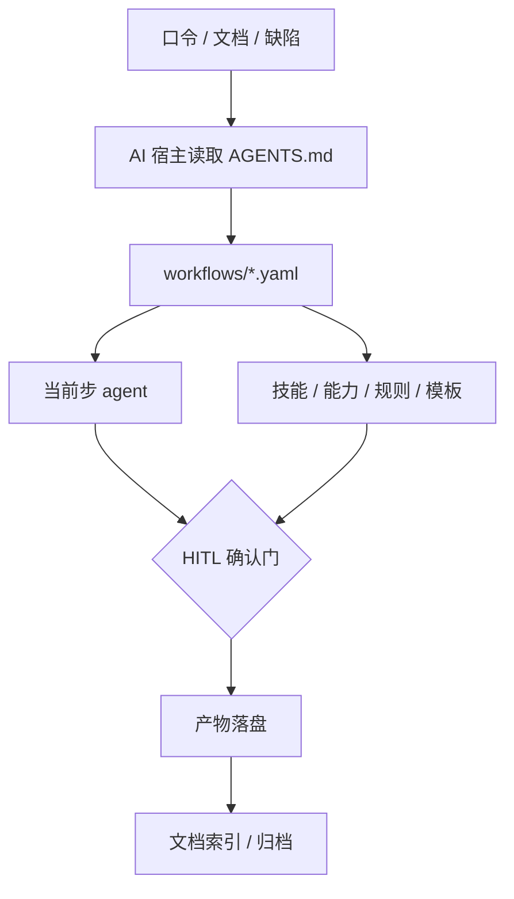

# AI Workflow

> 产品、开发、测试，三轨可执行的 AI 工作流规范。

**AI Workflow** 不是提示词合集，而是一套把工作流写成 AI 可执行文件的规范模板仓库。

每个包都包含流程定义、角色契约、规则红线、内置技能、可选能力与文档模板。复制一个包到项目根，挂上 `AGENTS.md` 入口，AI 就会按口令路由到对应流程，在确认门停下等你拍板，最后把产物写到约定位置。

流程不再散落在聊天记录里，而是版本化在仓库里。

**3 套独立包 · 20 条工作流 · 21 份角色契约 · 34 个内置技能 · 58 份模板/脚手架**

**关键词**：`YAML` · `Multi-Agent` · `Human-in-the-Loop` · `MCP` · `Agent Skills` · `Playwright` · `PowerShell` · `Python` · 文档治理

> **本仓是规范模板仓库（母版）**，用于管理、发布与同步，不充当业务执行现场。落地时按角色复制单个包到业务项目，三包互相独立。

---

## 项目背景

在多个项目中，产品、研发、测试与 AI 的协作方式往往依赖个人习惯和聊天记录：流程难以复用，确认点容易遗漏，产物散落在不同目录。AI Workflow 把三条工作流拆成可版本化的 YAML、角色契约、规则与模板，让 AI 在不同宿主中按同一套流程执行，并保留人工确认与文档留痕。

## 项目亮点

| 亮点 | 说明 |
| --- | --- |
| 声明式工作流 | `trigger → steps → agent`；条件步、确认门、质量闸都可审查 |
| 多 Agent 协作 | 21 份角色契约，按步骤加载，避免一次性塞满上下文 |
| 人工确认门 | 需求、PRD、方案、清单、提交、发布、回滚、验收、回写 |
| 能力可插拔 | 外部工具已安装即启用，未安装走降级路径 |
| 文档治理 | 标准目录、索引、归档、根目录白名单 |
| 自检工具链 | YAML schema、引用/锚点、版本单点、模板校验 |

## 为什么需要它

| 常见问题 | 本仓的做法 |
| --- | --- |
| 流程靠口口相传，换个人、换个会话就变样 | 流程写成 `workflows/*.yaml`，步骤、条件、门、产出都可审查 |
| AI 一上来就写代码/写文档，方向错了才返工 | 需求、PRD、方案、清单、提交、发布、回写设 HITL 确认门，未确认不进入下一步 |
| 每个项目都要重新解释一遍规范 | 整包复制即用；规则与实例分离，换项目只填档案 |
| 外部工具不一定装得齐 | 能力注册表：已安装即启用，未安装走降级路径，不阻塞流程 |
| 产物散落在聊天、桌面和项目根目录 | 文档治理：标准树、索引、归档、根目录白名单 |
| 规范越写越多，最后互相矛盾 | 单一出处；包自检检查引用、锚点、YAML 与版本单点 |

## 架构



六层结构：

| 层 | 作用 | 落点 |
| --- | --- | --- |
| Workflow 定义 | trigger → steps → agent；条件步与确认门 | `workflows/*.yaml` |
| Agent 契约 | 角色目标、必读、边界、产出 | `agents/*.yaml` |
| 规则红线 | 分级、确认门、证据、发布/验收、文档治理 | `规则/*.md` + `AGENTS.md` |
| 专业技能 | 每步的专业方法，随包生效，命中步必用 | `技能/<name>/SKILL.md` |
| 能力层 | 外部技能/工具建议，已装即用，未装降级 | `能力/00-能力注册表.md` |
| 文档治理 | 产物落位、索引、归档、根目录白名单 | `规则/工作流.md` §5 + `规则/模板/` |

四步执行模型：

1. **路由**：读包内 `AGENTS.md`，口令命中 workflow，首条输出 `route=workflow:... | step=...`。
2. **加载**：只读当前步的 agent 与命中的技能；同一会话内文件未变不重读。
3. **执行**：步内方法由 AI 自主选择；条件步按 `when` 跳过；步上 `hitl` 必须停下确认。
4. **落盘**：按模板写入标准目录，更新索引/计划/`activeContext.md`；收尾输出统一六段骨架。

执行宿主是任意支持 `AGENTS.md` 入口自动装载的 AI 编码工具，不自研编排引擎。包内文本与 YAML 不写死宿主名，换宿主只改实例档案。

## 三套包

| 包 | 定位 | 工作流 | 技能 | 角色契约 |
| --- | --- | ---: | ---: | ---: |
| [产品规范](./产品规范/README.md) | 产品轨：0→1 与迭代 | 9 | 11 | 6 |
| [开发规范](./开发规范/README.md) | 开发轨：按 L0～L3 裁剪 | 8 | 18 | 6 |
| [测试规范](./测试规范/README.md) | 测试轨：计划驱动执行 | 3 | 5 | 9 |

### 产品规范

从 0→1 到迭代交付的产品轨。只写需求、规则、原型、验收；技术架构、技术栈、数据库/API/部署留给开发轨。

- **工作流**：`new-product`（发现 → 立项 Go/Hold/Kill → 产品定义 → 交付 → 上市 → 复盘）· `plan`（目标/指标 → 路线图 → 本期范围/里程碑）· `prd`（需求池 → 优先级/立项 → PRD → 评审定稿）· `prototype`（IA → 线框 → 视觉/tokens → 高保真 → 设计评审 → 交接）· `showcase`（受众 → 故事线 → 演示脚本 → Demo → 材料/用户文档 → 彩排）· `change`（受理 → 分诊 → 影响评估 → 处置 → 联动 → 重审/关闭）· `defect`（拉取 → 读详情/附件 → 分析 → 处置 → 回写）· `deliver`（排期 → 跟进 → UAT → 发布 → 复盘）· `onboard`
- **质量门**：G0～G6，配套 PRD/原型/计划/UAT/复盘评分卡与追溯矩阵
- **主要产物**：`产品/` 下的产品计划、需求池、立项书、PRD、评审记录、原型、受理/变更单、交付计划、UAT、GTM、复盘

### 开发规范

按变更分级裁剪的开发轨。L0 微改只走澄清 → 实现 → 验证 → 提交；L1 常规加轻量需求卡/提测；L2 功能/迭代走全链；L3 高风险再加独立评审、安全/隐私检查、回滚演练、发布审批、发布后观察与复盘。

- **工作流**：`control`（开发计划 init/sync/check/run）· `intake`（收件 → 分类 → 影响分析 → 局部更新 → 吸收报告）· `change`（澄清 → 需求基线 → 方案/ADR → 任务清单 → 实施 → 评审 → 门禁 → 提测 → 提交）· `iterate`（迭代交付）· `defect-fix`（preflight → pull → fix → gates → menu → close → postrelease）· `release`（就绪检查 → 部署审批 → 部署 → 验证 → 回滚 → 观察 → 记录）· `retro`（复盘）· `onboard`
- **主要产物**：`{文档事实源目录}/` 下的开发计划、需求基线、方案/ADR、任务清单、提测单、发布说明、上线检查单、发布记录、UAT、复盘、文档索引
- **质量度量**：开发计划 §14 的 DORA/交付质量指标

### 测试规范

计划驱动的测试轨。`测试/测试计划.md` 是唯一编排载体，正式轨并列：功能全量/专项、探索式、接口、发布前（性能/安全/兼容）、缺陷。

- **工作流**：`testing`（分析 → 计划 → 生成 → 执行 → 报告）· `defect`（提交/查重/回归/平台协作）· `onboard`
- **执行**：R0 冒烟 → R1 正式 → R2+ 回归；UI 稳定主链路走 Playwright 脚本档，AI 做设计、探查、失败复核与探索式；能脚本不 AI
- **闸门**：覆盖三闸、冒烟前置、证据红线、准出评估；P0 未通过不得判整体通过
- **主要产物**：`测试/` 下的计划、报告、功能/接口/探索式/发布前用例与台账、P0 稳定冒烟清单、变更记录、脚本、证据、归档

### 独立落地，按需联动

三包互不依赖，落地通常只装一个。若同一项目已有其它包产物，可作为可选输入：PRD/需求文档 → 开发需求基线；提测单/测试报告 → 产品 UAT；产品缺陷 → 产品 `change` 受理；缺陷平台 → 产品/测试 `defect` 协作。输入缺失时一句话说明缺口，由用户提供或只用现有资料，不阻塞、不擅自启用另一包。

发布门分开：产品 `confirm_release` 是业务发布决策，开发 `confirm_deploy` 是工程部署审批；单包独立使用时各自覆盖自己的范围。

## 快速开始

### 环境要求

| 依赖 | 用途 | 是否必需 |
| --- | --- | --- |
| 支持 `AGENTS.md` 的 AI 编码工具 | 执行宿主 | 必需 |
| PowerShell 5.1+ | 包自检脚本 | 维护/自检时 |
| Python 3 + PyYAML | YAML schema、PRD/用例/清单/计划校验 | 可选 |
| Node.js + Playwright | 测试脚本档 | 测试脚本轨可选 |
| 浏览器 MCP | UI 功能/探索式执行 | 测试 UI 轨按需 |
| Git | 提交门与版本管理 | 建议 |

### 1. 获取仓库

```bash
# GitHub
git clone https://github.com/zhipenghhuang/AIWorkflow.git

# Gitee 镜像
git clone https://gitee.com/zhipenghhuang/AIWorkflow.git
```

### 2. 只复制一个包到项目根

```bash
# macOS / Linux
cp -r AIWorkflow/开发规范 /path/to/your-project/
```

```powershell
# Windows PowerShell
Copy-Item -Recurse "AIWorkflow\开发规范" "E:\path\to\your-project\"
```

> 业务项目只需要一个包 + 自己的文档目录，不要把整个母版仓复制进去。产品项目换成 `产品规范/`，测试项目换成 `测试规范/`。

### 3. 挂载项目根 AGENTS.md

已有 `AGENTS.md` 则追加，不覆盖原文；没有则新建：

```markdown
# AGENTS.md

本项目启用 **开发规范** AI 工作流包。

1. 先完整阅读 `开发规范/AGENTS.md`，再按其口令 → `workflows/*.yaml` 执行。
2. 本会话只启用开发规范（落地通常只装本包）。
3. 与本文冲突时以本文为准；细则以 `开发规范/AGENTS.md` 为准。
4. 文档按 `开发规范/规则/工作流.md` §5 落位；接入后先建 `文档索引.md`。
```

产品/测试项目把「开发规范」替换成对应包名。完整样例见各包 `规则/模板/根AGENTS薄指针.md`。

### 4. 让 AI 接入

```text
接入开发规范
```

AI 会按 `workflows/onboard.yaml` 建档、建文档树/索引、确认入库策略并打标 `landing=ok`。之后业务任务不再例行自检，直接路由执行。

### 5. 开始第一条工作流

```text
开发计划
```

或者直接从任意入口进入：

```text
写 PRD
生成测试计划
```

## 常用口令

| 包 | 说一句 | 会发生什么 |
| --- | --- | --- |
| 产品 | `启动新产品：{一句话}` | 0→1 发现、立项 Go/Hold/Kill、产品定义与计划 |
| 产品 | `产品计划` | 目标/指标 → 路线图 → 本期范围/里程碑 → 计划门 |
| 产品 | `收集需求` / `写 PRD` / `PRD 评审` | 需求池 → PRD → 独立评审 → 定稿 |
| 产品 | `画原型` / `准备演示` / `用户手册` | 原型链路，或展示脚本与对外材料 |
| 产品 | `需求变更` / `拉取我的产品缺陷` | 受理/分诊/处置/联动，或平台拉取/分析/回写 |
| 产品 | `UAT` / `发布` / `复盘` | 验收、发布决策与复盘 |
| 开发 | `开发计划` | 创建/更新开发计划：阶段、门、范围、下一步 |
| 开发 | `按开发计划执行` / `下一步` / `当前状态` | 从计划当前阶段续跑，执行到下一个门 |
| 开发 | `这是新一期方案` | `intake` 吸收新文档/变化，做影响分析与局部更新 |
| 开发 | `按方案实施` / `只出任务清单` | 方案落地或只出可独立验收的任务清单 |
| 开发 | `代码评审` / `提测` | 五轴评审，或产出提测单/发布说明/回滚预案 |
| 开发 | `发布` / `回滚` / `复盘` | 上线检查与审批、按预案回滚、事实→根因→行动项 |
| 测试 | `生成测试计划` | 范围/类型/轨道/回归/缺陷/探索章程/准入准出 |
| 测试 | `按测试计划执行` | 功能 → 接口 → 探索式 → 非功能 → 回归 → 缺陷闭环 |
| 测试 | `生成测试资产` / `执行探索式测试` | 用例生成或专项执行 |
| 测试 | `测试报告` / `准出评估` | 计划对照、准出结论、遗留风险 |
| 测试 | `提交缺陷` / `回归验证` | 查重、提交平台、回归与备注 |

## 确认门与质量闸

确认门只认 workflow 步骤上的 `hitl`，条件不满足会自动跳过。同一确认点只问一次；确认门是执行授权，不是澄清。

| 包 | 关键确认门 |
| --- | --- |
| 产品 | `confirm_go` 立项 · `confirm_plan` 产品计划 · `confirm_scope` 单需求范围 · `confirm_prd` PRD 定稿 · `confirm_design` 设计方向 · `confirm_prototype` 原型交接 · `confirm_change` 变更/缺陷处置 · `confirm_remark` 平台回写 · `confirm_release` 发布 · `confirm_commit` 提交 |
| 开发 | `confirm_plan` 开发计划 · `confirm_requirements` 需求基线 · `confirm_spec` 方案评审 · `confirm_backlog` 任务清单 · `confirm_deploy` 部署审批 · `confirm_rollback` 回滚 · `confirm_acceptance` 验收 · `confirm_commit` 提交 |
| 测试 | `confirm_plan` 测试计划 · `confirm_scope` 执行范围 · `confirm_commit` 提交 · `confirm_remark` 缺陷回写 |

关键质量闸：

| 闸 | 规则 |
| --- | --- |
| PRD 定稿 | 未定稿不排期；写不出验收标准 = 需求未定义完 |
| 方案评审 | 未批准不实施；破坏性变更必须有兼容与回退思路 |
| 任务清单 | RP/AC/DoR/DoD 覆盖；确认后冻结，变更走变更记录 |
| 代码门禁 | 失败不声称完成；禁止改断言、跳测试、关告警凑绿 |
| 发布 | 上线检查单 + 审批 + 回滚预案 + 验证；失败按预案回滚 |
| 测试准出 | P0 未过不得整体通过；证据可打开；缺口显式列出 |
| 缺陷回写 | 备注与状态同轮；附件回查；无权限走 export，不声称已回写 |

## 仓库结构

```text
AIWorkflow/
├─ 产品规范/
│  ├─ AGENTS.md          # AI 入口（口令 → workflow；版本单点）
│  ├─ workflows/         # 9 条流程：0→1 / 计划 / PRD / 原型 / 展示 / 受理 / 缺陷 / 交付 / 接入
│  ├─ agents/            # 6 个角色契约
│  ├─ 技能/              # 11 个内置专业技能
│  ├─ 能力/              # 可选能力注册表
│  ├─ 规则/              # 红线 · 质量门 · 模板 · 校验工具
│  └─ README.md
├─ 开发规范/
│  ├─ AGENTS.md
│  ├─ workflows/         # 8 条流程：开发计划 / 吸收 / 变更 / 迭代 / 缺陷 / 发布 / 复盘 / 接入
│  ├─ agents/            # 6 个角色契约
│  ├─ 技能/              # 18 个技能（含 02A～02F、03A/03B 子技能）
│  ├─ 能力/
│  ├─ 规则/
│  └─ README.md
├─ 测试规范/
│  ├─ AGENTS.md
│  ├─ workflows/         # 3 条流程：测试主链 / 缺陷 / 接入
│  ├─ agents/            # 9 个角色契约
│  ├─ 技能/              # 5 个技能
│  ├─ 能力/
│  ├─ 规则/              # 含轨契约、脚本执行、多 Agent 输出、Playwright 工具
│  └─ README.md
└─ README.md
```

每个包的内部结构一致：

```text
{包}/
├─ AGENTS.md             # AI 入口：开工纪律、口令表、确认门、维护约定
├─ workflows/*.yaml      # trigger → steps → agent / when / hitl / gate
├─ agents/*.yaml         # 角色目标、必读、边界、产出
├─ 技能/<name>/SKILL.md  # 随包生效，命中步必用，无需安装
├─ 能力/00-能力注册表.md  # 外部工具建议：已装即用，未装降级
├─ 规则/                 # 红线、工作流细则、模板、校验工具
└─ README.md             # 给人看的上手说明
```

### 文档落点

开发轨默认文档根为 `开发/`（旧项目可用 `docs/`）；产品产物统一进 `产品/`；测试产物统一进 `测试/`。项目根只保留白名单。

| 类别 | 落点 |
| --- | --- |
| 项目治理 | `00-项目治理/`：变更记录、待决项、决策记录 |
| 需求基线 | `01-需求基线/`：需求台账、需求规格/基线 |
| 设计基线 | `02-设计基线/`：方案、ADR |
| 计划与状态 | `03-计划与状态/`：任务清单 |
| 测试与验收 | `04-测试与验收/`：UAT、验收记录 |
| 发布与交付 | `05-发布与交付/`：提测单、发布说明、上线检查单、发布记录 |
| 复盘与改进 | `06-复盘与改进/`：版本/事故复盘 |
| 外部输入 | `资料/项目文档/`、`资料/原始素材/_收件箱/` |
| 索引入口 | `文档索引.md`、`开发计划.md` |
| 归档 | `_归档/{yyyyMMdd}-{版本}/` |

## 设计原则

- **框架固定，局部自主**：口令到 workflow 的映射、步上 `hitl`、输出骨架、证据与红线不可让；步内怎么探查、怎么改、怎么验，由 AI 自主选择。
- **规则与实例分离**：`workflows/`、`agents/`、`规则/` 通用；项目档案、基线、`activeContext.md` 和业务产物留在实例侧。
- **技能随包，能力可选**：技能给方法，随包复制、命中步必用；能力给工具，已安装即启用，未安装降级，不阻塞。
- **单一出处，版本单点**：`template_version` 只写在每个包的 `AGENTS.md`；同一规则只落一处，其余用指针。
- **文档现行有效**：只写当前存在的功能与规则；删除即移除，不留「旧方案/已废弃」；旧版归档，不堆「最终版2」。
- **宿主无关**：包内只写能力名，不写宿主名和本地路径；换宿主只改实例档案。

## 自检

改包后或用户点名时运行；业务任务不例行自检，接入时由 onboarding 核验一次并打标。

```powershell
powershell -ExecutionPolicy Bypass -File "产品规范/规则/tools/Test-Template.ps1"
powershell -ExecutionPolicy Bypass -File "开发规范/规则/tools/Test-Template.ps1"
powershell -ExecutionPolicy Bypass -File "测试规范/规则/tools/Invoke-TestWorkflow.ps1" -Action ValidateTemplateRefs
```

自检覆盖：引用可解析、章节锚点、workflows → agents、步标记词表、能力名声明、版本单点、YAML 语法与基本 schema（需 Python + PyYAML；未装时该项跳过并提示）。

单项校验：

```bash
python 产品规范/规则/tools/validate_prd.py <PRD.md>
python 开发规范/规则/tools/validate_tasklist.py <任务清单.md>
python 开发规范/规则/tools/validate_dev_plan.py <开发计划.md>
python 测试规范/规则/tools/validate_testcase.py <模块用例.md>
```

## 维护与版本

- **版本单点**：版本只写在各包 `AGENTS.md` 的 `template_version`；根 README 不缀版本号。
- **分支**：仅维护 `main`。
- **只改模板仓库**：`workflows/`、`agents/`、`规则/`、`技能/`、`能力/` 的修改先落在模板仓库；实例侧的直接改动会在整包同步时被覆盖。若实例已领先，先把差异回迁模板仓库，再同步。
- **改哪里**：改步骤 → `workflows/`；改角色 → `agents/`；改红线/输出 → `规则/`；改方法 → `技能/`；改工具建议 → `能力/`；改文档树/归档 → `规则/工作流.md` §5。
- **规则撰写标准**：有用、不冗余（单一出处）、不误导、高性价比。阻塞式确认门必须在 YAML 步上有对应 `hitl`。

## FAQ

**需要安装编排引擎吗？**

不需要。执行器就是支持 `AGENTS.md` 的 AI 编码工具；YAML 是给 AI 读的流程定义，不是运行时依赖。

**三个包必须一起装吗？**

不必。三包独立落地，通常只装一个。已有其它包产物时按需复用，不强制联动。

**没有 Python / Node.js 能跑吗？**

能。AI 工作流本身只依赖宿主；Python 用于 YAML schema 和文档校验，Node/Playwright 用于测试脚本档，缺失时走降级路径并提示一次。

**会不会强制写很多文档？**

不会。开发轨 L0 微改不强制文档；L1 轻量；L2/L3 才走完整文档链。测试轨按计划范围生成，不做全量资产库。

**支持哪些宿主？**

任何支持 `AGENTS.md` 入口自动装载与文件读写/命令执行/对话确认的工具均可，例如 Cursor、opencode、Claude Code 等。包本身不绑定宿主。

**可以改成我们团队的流程吗？**

可以。改模板仓库的 workflow、agent、规则或模板，跑一遍自检，再整包同步到项目；不要在实例侧直接改包内文件。

## 适用场景

**适合**：想把 AI 协作从「聊天」变成可复用流程的产品/研发/测试团队；需要人工审批、证据链和文档留痕的项目；要在多个项目、多个宿主之间复用同一套规范；希望 AI 按变更大小自动裁剪流程，而不是每次全量走一遍。

**不适合**：只想要一份提示词模板；无需流程与留痕的一次性脚本；希望 AI 完全自动、不要任何确认门的场景。

详细上手说明：

- [产品规范 README](./产品规范/README.md) · [产品规范 AGENTS](./产品规范/AGENTS.md)
- [开发规范 README](./开发规范/README.md) · [开发规范 AGENTS](./开发规范/AGENTS.md)
- [测试规范 README](./测试规范/README.md) · [测试规范 AGENTS](./测试规范/AGENTS.md)

## 反馈与贡献

欢迎通过 [Issues](https://github.com/zhipenghhuang/AIWorkflow/issues) 提出问题或建议；提交 PR 前请先说明改动范围与验证方式。

## 维护者

[zhipenghhuang](https://github.com/zhipenghhuang)

## License

本项目采用 [MIT License](./LICENSE)。
