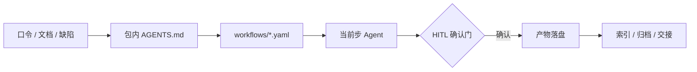

<div align="center">

# AI Workflow

**把产品 · 开发 · 测试，写成 AI 可执行的工作流。**

流程版本化在仓库里：口令即路由，确认门等人拍板，产物落到约定位置。

[](./LICENSE)
[](./CHANGELOG.md)
[](#三套独立包)
[](#它如何工作)
[](#确认门与质量闸)
[](#核心能力)
[](#快速开始)
[](https://github.com/zhipenghhuang/AIWorkflow)

`YAML` · `Multi-Agent` · `Human-in-the-Loop` · `Agent Skills` · `MCP` · `Playwright`

[快速开始](#快速开始) · [三套包](#三套独立包) · [常用口令](#常用口令) · [FAQ](#faq) · [CHANGELOG](./CHANGELOG.md)

</div>

---

## 这是什么

**AI Workflow** 是一套**规范模板仓库（母版）**：把产品、开发、测试三条协作轨，拆成 AI 可读可执行的包。

每个包包含：流程定义 · 角色契约 · 规则红线 · 内置技能 · 可选能力 · 文档模板。  
复制**一个包**到项目根，挂上薄 `AGENTS.md` 入口——AI 按口令路由到流程，在确认门停下等你拍板，并把产物写到约定位置。

> 本仓用于管理、发布与同步，**不充当业务执行现场**。落地只复制单个包；三包互相独立，也可同项目多包装载并自动探测。

| | |
| --- | --- |
| **是** | 可版本化的工作流 + 角色契约 + HITL 确认门 + 完成门校验 + 文档治理 |
| **不是** | 提示词合集、聊天技巧手册、自研编排引擎 |

---

## 核心能力

| | |
| --- | --- |
| **声明式工作流** | `trigger → steps → agent`；条件步、确认门、质量闸可审查 |
| **多 Agent 协作** | 角色契约按当前步加载；重阶段再读 playbook |
| **人工确认门** | 该停就停：需求 / PRD / 方案 / 清单 / 提交 / 发布 / 回滚 / 验收 |
| **完成只认门** | Agent 只提候选；`验证/` 门读清单 / diff / 证据后才授予完成态 |
| **能力可插拔** | 外部工具已装即用，未装降级；技能随包命中必用 |
| **按风险裁剪** | 产品 P0～P3 · 开发 L0～L3 · 测试 T0～T3 |
| **宿主无关** | 任意支持 `AGENTS.md` 的 AI 编码工具即可 |



<details>
<summary><strong>为什么需要它（痛点对照）</strong></summary>

| 常见痛点 | AI Workflow 的做法 |
| --- | --- |
| 流程靠口口相传，换人、换会话就变样 | 流程写成 `workflows/*.yaml`，步骤 / 条件 / 门 / 产出可审查 |
| AI 一上来就写代码或文档，方向错了才返工 | 需求、PRD、方案、清单、提交、发布设 HITL 确认门，未确认不进入下一步 |
| 跨角色交接靠聊天，接收方不知道要做什么 | 默认自洽主文档；按需 `{HO-ID}` 标准包；**未回执不得称已接收** |
| 每个项目都要重新解释一遍规范 | 整包复制即用；规则与实例分离，换项目只填档案 |
| 外部工具不一定装得齐 | 实例 `能力/` 清单：已配即用，未配降级，不阻塞 |
| 产物散落在聊天与桌面 | 文档治理：标准树、索引、归档、根目录白名单 |
| 规范越写越多、互相矛盾 | 单一出处；包自检检查引用、锚点、YAML 与版本单点 |

</details>

---

## 三套独立包

选一条轨即可上手；不必一次装全。数量以各包目录与自检为准。

| 包 | 定位 | 上手 |
| --- | --- | --- |
| **[产品规范](./产品规范/README.md)** | 0→1 与迭代：需求 · 竞品 · PRD · 原型 · UAT · 发布 | [说明](./产品规范/README.md) · [入口](./产品规范/AGENTS.md) |
| **[开发规范](./开发规范/README.md)** | L0～L3：澄清 → 实现 → 验证 → 提测 → 发布；含轻量单人轨 | [说明](./开发规范/README.md) · [入口](./开发规范/AGENTS.md) |
| **[测试规范](./测试规范/README.md)** | 计划驱动：分析 → 计划 → 生成 → 执行 → 报告 | [说明](./测试规范/README.md) · [入口](./测试规范/AGENTS.md) |

<details>
<summary><strong>产品 · 开发 · 测试 · 摘要</strong></summary>

**产品**：只写需求、规则、原型、验收；技术架构 / 栈 / 库 / API / 部署留给开发轨。主链含 `new-product` · `plan` · `prd` · `prototype` · `showcase` · `change` · `defect` · `deliver` · `handoff` · `onboard`（另含 `skill-audit`）。产物落在 `产品/`。

**开发**：L0 微改走澄清 → 实现 → 验证 → 提交；L1 加轻量需求卡；L2 全链；L3 再加独立评审、安全 / 回滚演练、发布审批。轻量 `solo`＝一页方案卡 → 确认 → 实施 → 自验 → 完成门。产物落在 `开发/`；根 `CHANGELOG.md`＝产品发版史（用户可见能力 / 破坏性 / 迁移 / 安全）。

**测试**：`测试/测试计划.md` 为版本级编排。主链 `testing` · `defect` · `handoff` · `onboard`（另含 `skill-audit`）。R0 冒烟 → R1 正式 → R2+ 回归；稳定主链路优先 Playwright；**能脚本不 AI**。P0 未过不得判整体通过。

**单包优先**：只强制本包工作根（`产品/` 或 `开发/` 或 `测试/`）；缺他包不阻塞。根 `CHANGELOG.md` 仅开发维护（无开发包则不建）；产/测写工作日志（发布决策可含对外摘要供开发落笔）。多包发版软序见开发文档治理。原始资料根推荐 `docs/`。交接：内容优先、包按需；未回执不得称「已接收」。产品 `confirm_release`＝业务决策；开发 `confirm_deploy`＝工程部署。

</details>

---

## 快速开始

### 环境要求

| 依赖 | 用途 | 必需？ |
| --- | --- | --- |
| 支持 `AGENTS.md` 的 AI 编码工具（Cursor / Claude Code / opencode 等） | 执行宿主 | **必需** |
| PowerShell 5.1+ | 包自检 / 完成门 | 维护与过门时 |
| Python 3 + PyYAML | 完成门、YAML schema、文档校验 | **完成门必需**；缺失=BLOCKED（工作流仍可读/执行，但不能声称完成） |
| Node.js + Playwright | 测试脚本档 | 测试脚本轨可选 |
| 浏览器 MCP | UI 功能 / 探索式执行 | 按需 |
| Git | 提交门与版本管理 | 建议 |

### 1. 获取仓库

```bash
git clone https://github.com/zhipenghhuang/AIWorkflow.git
cd AIWorkflow
```

### 2. 只复制一个包到项目根

```bash
# macOS / Linux（以开发规范为例；排除运行态 / 过程文件 / 缓存）
rsync -a --exclude .draft --exclude .state --exclude .gate --exclude __pycache__ \
  开发规范 /path/to/your-project/
```

```powershell
# Windows：排除运行态 / 过程文件 / 缓存
robocopy "开发规范" "E:\path\to\your-project\开发规范" /E /XD .draft .state .gate __pycache__
```

> 业务项目只需要**包 + 自己的文档目录**，不要把整个母版仓复制进去。产品 / 测试换成对应包名。
>
> **母版 / 实例**：母版只维护通用高标准。复制后的包默认不改；发现不匹配时先输出拟改内容 / 原因 / 影响，确认后只改当前实例。项目特例优先改产出文档；通用改进回母版升版本。

### 3. 挂载项目根 `AGENTS.md`

**分层**：包内规范 = 通用规则；项目档案（或产品档案 / 环境基线）= 项目事实；根 `AGENTS.md` = 包挂载 +（可选）落地项目自写的对 AI 额外要求——**母版不规定偏好正文**。

已有则**追加**挂载段，不覆盖原文；没有则新建：

```markdown
# AGENTS.md

本项目启用 **开发规范** AI 工作流包。

1. 新会话：先读 `开发规范/AGENTS.md` **§0 硬节** → 命中口令行 → `workflows/*.yaml` **当前 step 块**；不要通读 §0～§3 全文或整本规则/技能/模板。
2. 已路由中段：按 `开发规范/规则/核心/规则重锚.md` 心跳，不重读 §0 全文。
3. 本会话按开发规范执行（单包装载；多包装载见挂载样例「已启用包」+ 本文 **意图→包**）。
4. 与本文冲突时以本文为准；细则以 `开发规范/AGENTS.md` 为准。
5. 文档按 `开发规范/规则/工作流.md` §5 落位；接入后先建 `文档索引.md`。
```

完整样例（含多包路由、Cursor globs）见各包 `根AGENTS薄指针.md` / `cursor-rule样例.mdc`。

### 4. 让 AI 接入，然后开跑

对 AI 说：

```text
接入开发规范
```

再例如：

```text
开发计划
```

也可以直接说：`轻量开发` · `写 PRD` · `生成测试计划` · `按方案实施` ……

成功标志：AI 首条输出含 `route=… | step=…`，并开始按包内 workflow 推进（遇确认门会停下等你拍板）。

---

## 常用口令

对 AI 说一句人话即可；命中后按 workflow 执行到产出或下一个确认门。

| 包 | 说一句 | 会发生什么 |
| --- | --- | --- |
| 产品 | 任意自然语言描述需求/反馈 | 五元组入口判定 → 意图类路由 |
| 产品 | `启动新产品：{一句话}` / `产品计划` / `写 PRD` / `画原型` | 0→1 · 计划门 · PRD · 原型 |
| 产品 | `需求变更` / `UAT` / `发布` / `复盘` | 变更 · 验收 · 发布决策 · 复盘 |
| 开发 | 任意自然语言描述问题/需求 | 五元组入口判定 → 意图类路由 |
| 开发 | `轻量开发` / `我有个想法：…` | 方案卡 → 确认 → 实施 → 自验 → 收尾 |
| 开发 | `开发计划` / `按方案实施` / `代码评审` / `提测` | 续跑计划 · 实施 · 评审 · 提测 |
| 开发 | `发布` / `回滚` / `复盘` | 上线检查 · 回滚 · 行动项 |
| 测试 | `生成测试计划` / `按测试计划执行` | 计划门 → 分轨执行 → 报告 |
| 测试 | `测试报告` / `提交缺陷` / `回归验证` | 准出 · 查重提交 · 回归 |
| 三包 | `生成交接包` / `装配能力` / `体检能力` | 交接 / 装工具 / 就地优化技能·能力 |

更完整口令表见各包 `AGENTS.md`（产品/开发 §3，测试 §2）。口语未命中时，按各自 `规则/核心/入口判定.md` 做意图判定。

<details>
<summary><strong>多包：意图→包（歧义时先查本表）</strong></summary>

单包装载无需本表。同项目启用 ≥2 个包时，口语可能命中多包——**先定包，再走该包口令/入口判定**；无法唯一则一问 + 推荐。

| 用户信号（同义即可） | 进哪包 | 备注 |
| --- | --- | --- |
| 需求/PRD/原型/UAT/产品计划/立项/竞品 | **产品** | |
| 产品侧缺陷评估、PRD 不符、平台产品单回写 | **产品** | `defect` |
| 改代码/方案实施/提测/代码评审/开发计划 | **开发** | |
| 修 Bug、指派开发、复现红证、产品回复后回流 | **开发** | `defect-fix` |
| 测试计划/用例/按计划执行/准出报告 | **测试** | |
| 交平台缺陷、测试查重、测试回归 | **测试** | `defect` |
| 「发布」= 业务能否上线 / UAT 结论 | **产品** | `confirm_release` |
| 「发布」= 部署/回滚/生产变更 | **开发** | `confirm_deploy` |
| 「发布」= 测试准出/报告能否发 | **测试** | `report` |
| 「下一步/继续」 | **看** `activeContext` 当前包分节与计划 §0 | 无焦点则一问 |
| 「提交/推送/交接包」 | **当前会话正在执行的包** | 未开跑则一问 |
| 无法唯一 | 一问 | 附推荐包与取舍 |

根 `AGENTS.md` 列「已启用包」；一次会话只跑一个包。Cursor 可用各包模板 `cursor-rule样例.mdc`（按目录 globs，勿三包同时 alwaysApply）。

</details>

---

## 它如何工作

五步执行模型：

1. **路由** — 多包先定包；新会话读包内 `AGENTS.md` **§0 硬节** → 命中 workflow；首条输出 `route=… | step=… | reads=…`；纯解释走 `readonly:analysis`（**禁止通读 §0～§3 全文**）
2. **加载** — 新会话：§0 → 当前 step 块 → 读取索引当前行 → 当前 agent → 命中技能/playbook。**同会话中段**：【规则心跳】重锚（见各包 `规则/核心/规则重锚.md`），不重读 §0 全文
3. **执行** — 步内方法由 AI 自主；`when` 条件跳过；步上 `hitl` 必须确认；切步/过门/约每 5～8 轮须心跳
4. **验证** — `验证/Invoke-Gate.ps1`；只有门能授予 `COMPLETE` / `PASS` / `READY`
5. **落盘** — 写入本包标准目录，更新索引 / 计划 / 项目侧 `activeContext.md`

<details>
<summary><strong>分层落点</strong></summary>

| 层 | 落点 |
| --- | --- |
| Workflow | `workflows/*.yaml` |
| Agent 契约 | `agents/*.yaml` |
| 规则 / 门 / 读取索引 / 重锚 | `规则/门.md` · `规则/读取索引.md` · `规则/核心/规则重锚.md` |
| 协作交接 | `规则/协作/` + `workflows/handoff.yaml` |
| Stage playbook | `规则/playbooks/*.md` |
| 专业技能 | `技能/<name>/SKILL.md` |
| 能力层 | 包内契约+参考目录；实例真源 `{工作根}/能力/` |
| 验证层 | `验证/`（运行态 → 项目根 `.gate/`） |
| 文档治理 | `规则/文档治理.md` + `规则/模板/` |

执行宿主是任意支持 `AGENTS.md` 自动装载的 AI 编码工具，**不自研编排引擎**。

</details>

---

## 确认门与质量闸

确认门只认 workflow 步骤上的 `hitl`；条件不满足会自动跳过。开跑前按各包 `规则/核心/澄清.md`：先分析，再给「我的理解 + 建议 + 需要你拍板（0～1 个）」；总提问 ≤3。

| 包 | 关键确认门 |
| --- | --- |
| 产品 | 立项 · 计划 · 范围 · PRD · 设计 · 原型交接 · 变更 · 交接 · 发布 · 提交 |
| 开发 | 计划 · 需求基线 · 方案 · 任务清单 · 交接 · 部署 · 回滚 · 验收 · 提交 |
| 开发（solo） | 产品定义（按需） · 方案卡 · 提交 |
| 测试 | 计划 · 执行范围 · 交接 · 提交 · 缺陷回写 |

| 闸 | 规则 |
| --- | --- |
| PRD / 方案 / 清单 | 未定稿不排期；未批准不实施；RP / AC / DoR / DoD 覆盖后冻结 |
| 代码门禁 | 失败不声称完成；禁止改断言、跳测试、关告警凑绿 |
| 发布 | 上线检查单 + 审批 + 回滚预案 + 验证 |
| 测试准出 | P0 未过不得整体通过；证据可打开；缺口显式列出 |
| 交接 | 未回执不得称「已接收」；可称「已发送」 |

---

## 仓库结构

```text
AIWorkflow/
├─ 产品规范/          # 产品轨母版
├─ 开发规范/          # 开发轨母版（含轻量单人轨）
├─ 测试规范/          # 测试轨母版
├─ CHANGELOG.md       # 母版仓产品发版史
├─ THIRD_PARTY.md     # 第三方方法与来源
├─ LICENSE            # MIT
└─ README.md
```

每个包内部结构一致：

```text
{包}/
├─ AGENTS.md             # AI 入口（版本单点）
├─ README.md             # 给人看的上手说明
├─ workflows/*.yaml
├─ agents/*.yaml
├─ 技能/<name>/SKILL.md
├─ 能力/00-能力契约.md · 参考目录.md
├─ 规则/                 # 门 · 读取索引 · 核心/协作/模板/tools …
└─ 验证/                 # 检查矩阵、完成门；运行态 → .gate/
```

<details>
<summary><strong>文档落点（实例侧）</strong></summary>

各包只强制本包工作根；未装的包不必建对应目录。项目根只保留白名单（档案入口、`activeContext.md`、原始资料根等）。

| 类别 | 落点 |
| --- | --- |
| 开发轨 | `开发/00-项目治理/` ～ `08-复盘与改进/`；能力 SSOT `开发/能力/` |
| 产品版本目录 | `产品/{版本或主题}/`（`01-需求与定义`～`06-复盘`，按需）；能力 SSOT `产品/能力/` |
| 测试轨 | `测试/测试计划.md` · `测试/测试报告.md` · 分轨目录；能力 SSOT `测试/能力/` |
| 原始资料根 | 推荐 `docs/` + `资料索引.md` |
| 交接 | `{包}/交接/出站\|入站/{类别}/`（升包含 `{HO-ID}/`；台账同目录） |
| 索引入口 | `文档索引.md` · `开发计划.md` · `activeContext.md` |
| 产品发版史 | `CHANGELOG.md`（开发维护；用户可见能力 / 破坏性 / 迁移 / 安全） |

</details>

---

## 设计原则

- **框架固定，局部自主** — 口令映射、步上 `hitl`、输出骨架、证据与红线默认按规则；冲突时先说明风险，用户再次明确后以用户为准。
- **完成只认门** — Agent 不能自证 `COMPLETE` / `PASS` / `READY`。
- **按风险分级** — 低风险少文档，高风险才全链。
- **规则与实例分离** — 通用规范在包内；项目档案与业务产物在实例侧。
- **技能随包，能力跟实例** — 技能给方法；能力选型/绑定在 `{工作根}/能力/`，包内仅契约与参考目录。
- **单一出处** — `template_version` 只写在各包 `AGENTS.md`；根 README 不缀版本号为权威源（徽章仅导航提示，真源仍看各包）。
- **文档现行有效** — 只写当前存在的功能与规则。
- **内容优先 · 包按需** — 默认自洽主文档；升包才 `{HO-ID}`。
- **宿主无关** — 包内只写能力名，不写宿主名和本地路径。
- **三维同向 / 做减法** — 兼顾 UX · DX · AX；界面先删无决策价值文案。

---

## 适用场景

**适合**

- 想把 AI 协作从「聊天」变成可复用流程的产品 / 研发 / 测试团队
- 需要人工审批、证据链和文档留痕的项目
- 要在多个项目、多个宿主之间复用同一套规范
- 希望 AI 按变更大小自动裁剪流程

**不适合**

- 只想要一份提示词模板
- 无需流程与留痕的一次性脚本
- 希望 AI 完全自动、不要任何确认门的场景

---

## FAQ

**需要安装编排引擎吗？**  
不需要。执行器就是支持 `AGENTS.md` 的 AI 编码工具；YAML 是给 AI 读的流程定义。

**三个包必须一起装吗？**  
不必。默认单包独立落地；多包联动可选，不因缺他包阻塞。

**没有 Python / Node.js 能跑吗？**  
工作流可以读、可以按步骤执行；但**完成门需要 Python**，缺失会返回 `BLOCKED`，不会降级成“已完成”。Node.js 只在测试脚本轨需要，缺失按降级处理。

**会不会强制写很多文档？**  
不会。开发 L0 不强制文档；L1 轻量；L2/L3 才走完整链。测试按计划装填（suite=core|module|full）。

**支持哪些宿主？**  
任何支持 `AGENTS.md` 入口自动装载与文件读写 / 命令执行 / 对话确认的工具均可。包本身不绑定宿主。

**可以改成我们团队的流程吗？**  
可以。落地后直接改项目里的包副本（推荐「体检能力」确认后再改）。若维护通用母版并多项目同步：优先在母版改，自检后整包同步——同步会覆盖未回灌的实例侧包内改动。

**版本怎么看？**  
只认各包 `AGENTS.md` 的 `template_version`；根 [CHANGELOG.md](./CHANGELOG.md) 记产品发版史，不是版本声明源。

---

<details>
<summary><strong>自检与完成门（维护 / 贡献时）</strong></summary>

改包后或用户点名时运行；业务任务不例行自检。自检为本地/按需，不依赖 CI。执行契约见各包 `规则/核心/执行契约.md`；外部方法来源见 [THIRD_PARTY.md](./THIRD_PARTY.md)。

```powershell
powershell -ExecutionPolicy Bypass -File "产品规范/规则/tools/Test-Template.ps1"
powershell -ExecutionPolicy Bypass -File "开发规范/规则/tools/Test-Template.ps1"
powershell -ExecutionPolicy Bypass -File "测试规范/规则/tools/Invoke-TestWorkflow.ps1" -Action ValidateTemplateRefs
python 产品规范/规则/tools/check_skills.py 产品规范 --strict
python 开发规范/规则/tools/check_skills.py 开发规范 --strict
python 测试规范/规则/tools/check_skills.py 测试规范 --strict
```

完成门示例：

```powershell
powershell -ExecutionPolicy Bypass -File "开发规范/验证/Invoke-Gate.ps1" -ProjectRoot "."
powershell -ExecutionPolicy Bypass -File "测试规范/验证/Invoke-Gate.ps1" -Mode report -ProjectRoot "."
powershell -ExecutionPolicy Bypass -File "产品规范/验证/Invoke-Gate.ps1" -Mode prd -ProjectRoot "."
```

单项校验（PRD / 任务清单 / 用例 / 交接包等）见各包 `规则/tools/`。

</details>

---

## 文档导航

| 文档 | 说明 |
| --- | --- |
| [产品规范 README](./产品规范/README.md) · [AGENTS](./产品规范/AGENTS.md) | 产品轨上手与 AI 入口 |
| [开发规范 README](./开发规范/README.md) · [AGENTS](./开发规范/AGENTS.md) | 开发轨上手与 AI 入口 |
| [测试规范 README](./测试规范/README.md) · [AGENTS](./测试规范/AGENTS.md) | 测试轨上手与 AI 入口 |
| [CHANGELOG](./CHANGELOG.md) | 母版仓产品发版史 |
| [THIRD_PARTY](./THIRD_PARTY.md) | 第三方方法与来源 |
| [LICENSE](./LICENSE) | MIT |

---

## 反馈与贡献

欢迎通过 [Issues](https://github.com/zhipenghhuang/AIWorkflow/issues) 提出问题或建议。

提交 PR 前请说明：

1. **改动范围**（哪个包 / 哪一层：workflow · agent · 规则 · 技能 · 模板）
2. **验证方式**（跑了哪些自检 / 完成门）
3. 若改了规则或路径，是否同步了读取索引与包 README

<details>
<summary><strong>维护约定</strong></summary>

- 改步骤 → `workflows/`；改角色 → `agents/`；改红线 / 输出 → `规则/`；改方法 → `技能/`；改槽位契约/参考目录 → 包内 `能力/`；改项目选型/绑定 → 实例 `{工作根}/能力/`
- 落地：「体检能力」技能改包内 `技能/`，能力改实例 `能力/`；契约通用改进回母版
- 维护通用母版时：改动先落本仓再同步；实例 `能力/` 不在包内，不被包同步覆盖
- 分支：仅维护 `main`

</details>

---

## 维护者

[zhipenghhuang](https://github.com/zhipenghhuang)

## License

本项目采用 [MIT License](./LICENSE)。
