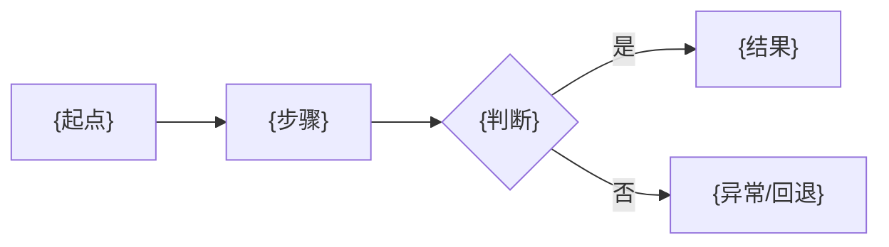

# {项目} 项目说明

> **归属**：单包/无产品包时由开发轨维护；多包且产品包已有同名文件时只读引用，不复制第二份。
> **落盘**：`{workroot}/project-guide.md`；单包即 `docs/project-guide.md`，多包即 `docs/development/project-guide.md`（仅单包/无产品包时）。
>
> **定位**：项目当前状态的单一说明基线（Project Handbook / Current-State Reference）。  
> **读者**：新成员、产品/开发/测试/运维、交接对象、审计、AI。  
> **用途**：理解项目全貌；变更前看现状；交接/审计/对外材料底稿。  
> **不是**：PRD、技术设计、变更日志、测试报告、任务清单。  
> **权威边界**：业务行为/规则/角色/边界以本文为准；技术实现以技术设计/ADR 为准；历史以 `CHANGELOG`/变更单为准；验收以测试报告/UAT 为准。  
> **维护**：一份文件、就地更新；不追加版本节；删除即移除；历史/决策/证据/实现细节不进正文。  
> **自检**：`python rules/tools/validate_project_guide.py <本文路径> --strict`。

---

## 0. 文档说明

### 0.1 读者与用途

| 读者 | 最关心 | 建议读法 |
| --- | --- | --- |
| 新成员 / 新 AI 会话 | 项目是做什么的、从哪看 | 先读 §1～§3，再按模块读 §5 |
| 产品 / 业务 | 现在有什么、规则和边界是什么 | §1～§5、§9 |
| 开发 | 改动点的现有行为、影响谁 | §3～§6、§10 |
| 测试 | 当前功能/角色/状态/权限覆盖 | §2、§3、§5、§6 |
| 运维 / 交接 | 系统概览、模块边界、限制 | §1、§3、§9、§10 |
| 审计 / 管理 | 当前功能、权限、控制点 | §2、§5、§6 |

### 0.2 权威边界

| 问题 | 以什么为准 | 本文角色 |
| --- | --- | --- |
| 业务行为、规则、角色、边界 | 本文 | 唯一正文 |
| 本期要改什么、AC、范围 | PRD / 迭代方案 / 变更单 | 只引用 ID，不复制正文 |
| 技术实现、接口、数据、部署 | 技术设计 / ADR / API 契约 | 只写系统概览并链接 |
| 为什么这样选 | ADR / 决策记录 | 只链接，不写论证过程 |
| 这版改了什么 | `CHANGELOG` / 变更单 | 不写版本史 |
| 验没验过 | 测试报告 / UAT | 不写验收证据 |
| 排期、进度、任务 | 开发计划 / 任务清单 | 不写执行状态 |

### 0.3 维护规则

- **一份文件**：项目级只维护本文件；不另建“第二份项目说明”或分卷副本。
- **就地更新**：变更被接受/发布时，直接改受影响章节；删除的内容直接移除。
- **禁止追加**：文末不追加“vX.Y 新增一节”或过程性回顾段。
- **一条规则一次**：功能、规则、状态、权限在 §5 写一次；其他章节用 ID 引用，不重复抄。
- **历史/证据/实现分离**：版本史进 `CHANGELOG`，决策进 ADR，验收证据进测试报告/UAT，实现细节进方案/技术设计。
- **变更合并**：PRD/变更单的增量只作为输入；合并后本文件只保留终态。
- **评审**：每 release 一次现状对账；每季度一次全量复核；事故/大改后专项复核。
- **自检**：提交/发布前跑 `validate_project_guide.py --strict`；结构、历史词、表格列数、链接不合格先修。

---

## 1. 项目概览

> 回答：这个项目是什么、为什么存在、现在做到哪、边界在哪。

| 项 | 内容 |
| --- | --- |
| 一句话定位 | `{为谁解决什么问题}` |
| 业务背景 | `{为什么做；来源/日期}` |
| 目标 | `{业务目标 + 成功标准}` |
| 当前阶段 | `{开发/试运行/已发布}` |
| 范围 | `{做什么}` |
| 非目标 | `{明确不做；原因}` |
| 关键约束 | `{合规/预算/时间/现有系统}` |

## 2. 用户与角色

> 回答：谁在用、能做什么、不能做什么、数据范围是什么。

| 角色 | 谁 | 核心任务 | 操作权限 | 数据范围 |
| --- | --- | --- | --- | --- |
| `{角色}` | `{岗位/外部单位}` | `{任务}` | `{能做/不能做}` | `{本人/组织/全部}` |

- 越权表现：`{隐藏/禁用/拒绝/提示}`
- 权限来源：`{PRD/权限矩阵/系统配置}`

## 3. 功能地图

> 回答：项目由哪些模块/功能组成，入口在哪。功能 ID 一经分配不复用。

| 模块 | 功能 ID | 功能 | 主要入口 | 主要角色 | 状态 |
| --- | --- | --- | --- | --- | --- |
| `{模块}` | `F-01` | `{功能}` | `{菜单/路由/终端}` | `{角色}` | `{现行/未发布/不做}` |

- 模块划分与产品导航保持一致；不按版本/时间分章。
- 功能下线后直接移除；不在表中保留旧状态标识。

## 4. 核心业务链路

> 回答：端到端主流程怎么走，异常/回退在哪。

- 主链路：`{订单→交付 / 采购→入库 / ...}`
- 异常/补偿：`{失败、撤销、退回、重试}`
- 跨模块依赖：`{上游/下游/共享数据}`

## 5. 功能详述

> 按模块写“当前行为”。每模块只写一次；规则给 `R-xx`，验收要点给 `AC-xx`。

### 5.1 {模块}

#### 5.1.1 目标与边界

- 模块目标：`{…}`
- 不负责：`{…}`

#### 5.1.2 角色与入口

| 角色 | 入口 | 能做什么 | 数据范围 |
| --- | --- | --- | --- |
| `{角色}` | `{菜单/路由}` | `{…}` | `{…}` |

#### 5.1.3 主流程与状态

- 主流程：`{起点→步骤→结果}`
- 状态机：`{A --事件--> B}`；非法跃迁：`{…}`
- 异常/边界：`{空数据/重复/并发/超时/权限不足}`

#### 5.1.4 规则与不变量

| 规则 ID | 规则 | 适用范围 | 来源 |
| --- | --- | --- | --- |
| `R-01` | `{必须/禁止/阈值/计算口径}` | `{模块/对象}` | `{PRD/确认单}` |

#### 5.1.5 权限与数据边界

| 操作 | 权限码/角色 | 数据范围 | 越权表现 |
| --- | --- | --- | --- |
| `{动作}` | `{…}` | `{本人/组织/全部}` | `{隐藏/禁用/拒绝}` |

#### 5.1.6 验收要点

| AC ID | 场景 | 可观察结果 |
| --- | --- | --- |
| `AC-01` | `{条件+动作}` | `{页面/提示/状态}` |

> 只写验收要点，不写测试步骤/证据；证据链接到测试报告/UAT。

## 6. 跨模块规则

> 回答：多个模块共同遵守的规则；单模块内部规则留在 §5。

| 主题 | 规则 | 适用范围 | 来源 |
| --- | --- | --- | --- |
| 权限 | `{…}` | `{…}` | `{…}` |
| 数据范围 | `{…}` | `{…}` | `{…}` |
| 状态/数量 | `{…}` | `{…}` | `{…}` |
| 审计/留痕 | `{…}` | `{…}` | `{…}` |
| 幂等/并发 | `{…}` | `{…}` | `{…}` |
| 通知/待办 | `{…}` | `{…}` | `{…}` |

## 7. 非功能要求

> 只写当前生效的目标/约束；未确认写“待确认”，不写成事实。

| 维度 | 要求 | 验证方式 | 来源 |
| --- | --- | --- | --- |
| 性能 | `{响应/吞吐/容量}` | `{压测/监控}` | `{…}` |
| 安全 | `{认证/授权/脱敏}` | `{评审/扫描}` | `{…}` |
| 可用性 | `{SLA/降级/恢复}` | `{演练/监控}` | `{…}` |
| 兼容性 | `{浏览器/终端/版本}` | `{矩阵/回归}` | `{…}` |
| 可观测性 | `{日志/指标/告警}` | `{看板/告警}` | `{…}` |

## 8. 术语表

| 术语 | 定义/口径 | 来源 |
| --- | --- | --- |
| `{术语}` | `{…}` | `{PRD/业务确认}` |

## 9. 当前版本与边界

> 只写“当前可用/不可用”的功能边界，不写版本变更史。

| 项 | 内容 |
| --- | --- |
| 当前版本 | `{ver}` |
| 当前可用范围 | `{已发布/验证站/仅开发}` |
| 未发布 | `{功能；状态；预计版本（若已确认）}` |
| 本期不做 | `{功能；原因}` |
| 已知限制 | `{限制；影响；规避}` |

## 10. 关联文档

> 只给链接和一句用途；不复制正文。

| 文档 | 路径 | 用途 |
| --- | --- | --- |
| 产品计划 | `{workroot}/product-plan.md` | 目标/范围/里程碑 |
| 本期 PRD/方案 | `{path}` | 本期变更与 AC |
| 技术设计/ADR | `{path}` | 技术实现与决策 |
| 接口/数据契约 | `{path}` | API/DB 细节 |
| 测试报告/UAT | `{path}` | 验收证据 |
| 版本变更 | `CHANGELOG.md` | 用户可见变化史 |
| 文档索引 | `{workroot}/INDEX.md` | 全部文档导航 |
