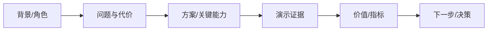

# 演示与故事线（技能 · 随包生效）

> 用于：`showcase` 的 audience / story / demo / dryrun 步。  
> 原则：**先受众，后故事；先真实，后效果；演示必须与当前项目一致。**

## 1. 受众与目标

| 受众 | 关心 | 演示重点 | 时长 |
| --- | --- | --- | --- |
| 老板/管理层 | 价值、成本、风险 | 目标/ROI/进度/决策点 | 10～20 分钟 |
| 客户/买方 | 问题能否解决、可信度 | 场景/证据/案例/下一步 | 20～30 分钟 |
| 一线用户 | 好不好用、省不省事 | 任务路径/效率/异常处理 | 15～30 分钟 |
| 技术/评审 | 可行性、集成、风险 | 边界/接口/约束（技术细节由开发补充） | 20～40 分钟 |

- 明确：目标（汇报/演示/培训/销售）、成功标准、保密边界、**不演示什么**。
- 只讲当前项目真实能力；未实现/未验证的能力不演、不承诺。

## 2. 故事线与流程图

用 Mermaid 流程图固定故事骨架：

- 每个节点写一句“证据”（PRD/原型/构建/数据/客户反馈）。
- 业务流程图可以画“用户任务流”；**不画技术架构**（技术架构归开发）。
- 故事线只保留 3～5 个关键点；每点多说“所以呢（价值）”，少说功能清单。

## 3. 演示脚本（点击级）

每个场景一张表：

| 项 | 内容 |
| --- | --- |
| 场景目标 | `{观众要看到什么}` |
| 入口 | `{菜单 → 页面 → Tab}` |
| 逐步路径 | `{点击/输入/选择，逐步写清控件与数据}` |
| 数据 | `{真实/脱敏样本；seed/重置}` |
| 预期 | `{观众看到的可观测结果}` |
| 兜底 | `{失败时切录屏/截图/原型}` |
| 时长 | `{分钟}` |

- 路径详细到按钮/字段/行定位；不要“点一下这里”。
- 先主路径，再一个异常/边界（证明可靠性）；不要把所有功能都演一遍。
- 每个场景之间用一句话过渡，回到故事线。

## 4. Q&A 与异议

| 可能的异议 | 回应要点 | 证据 |
| --- | --- | --- |
| 太贵/ROI | 成本 vs 收益/回收期 | 数据/案例 |
| 不安全/不合规 | 权限/审计/脱敏/合规 | PRD/测试报告 |
| 现在能用吗 | 当前版本/范围/限制 | UAT/发布说明 |
| 和竞品比 | 差异化/场景适配 | 对比表（来源+日期） |

- 不知道就记录，不编；会后回填。
- 对外承诺必须已确认；未确认写“待评估”。

## 5. 项目对齐检查（必过）

- 每个演示点能回指 PRD F/A/AC 或原型/构建；
- 术语、数字、截图、流程与当前版本一致；
- 未实现/未发布能力已标“不演示/后续”；
- 真实客户数据已脱敏；演示环境与生产隔离；
- 录屏/截图兜底可用；演示账号/数据可重置。

## 6. 反模式

- 功能巡游，没有故事；只讲“有什么”，不讲“为什么值”。
- 演示未完成功能/假数据不标注；承诺未确认。
- 路径太粗，现场找不到按钮；没有兜底。
- 一套材料打所有受众；超时；Q&A 临场编。
