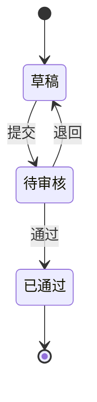

# {版本或主题} 迭代方案

> **定位**：多需求/多功能的版本级方案与验收基线。单需求细节仍以 PRD 为准；本文件负责**范围、功能覆盖、验收矩阵、发布条件、决策**。
> **技术边界**：只写业务规则、范围、验收与发布条件；技术架构/DB/API/部署归开发方案。
> **验收资产**：第 7～8 节是测试/UAT 验收资产，第 9 节是追溯对账；开发只承接 `DEV-AC` 子集，`QA-AC/REL-AC` 由测试/UAT 执行。
> **事实字段**：客户/用户原话、角色、数据、日期、指标、范围、优先级必须有来源或用户确认；无来源写「待验证」。

## 0. 一页状态

| 项 | 内容 |
| --- | --- |
| 一句话目标 | `{…}` |
| 成功标准 | `{北极星 + 1～2 辅助指标 + 观察窗口}` |
| 本期范围 | 做：`{…}` ｜ 不做：`{…}` |
| 版本/里程碑 | `{版本/计划日期/提测/UAT/发布}` |
| 当前阶段/门 | `{立项/PRD/开发中/提测/UAT/已发布}` + `{confirm_plan/confirm_prd/confirm_release}` |
| 发布条件 | `{P0 通过 + 阻断缺陷清零 + UAT 签字 + 回滚预案}` |
| 关键依赖 | `{系统/团队/账号/数据/合规}` |
| 待确认 | `{Q-xx + 责任人 + 期限}` |

## 1. 背景与目标

| 依据 | 内容 | 来源 + 日期 |
| --- | --- | --- |
| 业务问题/机会 | `{…}` | `{访谈/数据/工单}` |
| 用户/客户 | `{…}` | `{…}` |
| 竞品/市场 | `{…}` | `{…}` |
| 合规/约束 | `{…}` | `{…}` |

- 目标：`{可衡量目标}`
- 非目标：`{明确不做 + 原因}`
- 成功指标：`{指标/基线/目标/窗口}`

## 2. 范围与边界

| 类型 | 内容 | 说明 |
| --- | --- | --- |
| 核心必需 | `{F-xx…}` | 不交付则版本不成立 |
| 限定扩展 | `{F-xx…}` | 仅原型/已设计范围，不新增 |
| 本期不做 | `{…}` | 原因 + 后续计划 |
| 兼容边界 | `{历史数据/旧路径/默认值}` | 不因新功能破坏原规则 |

> 范围变更走变更单；不得在实施中静默删减/扩展已确认范围。

## 3. 功能清单与优先级

| ID | 功能 | 优先级 | 用户价值 | PRD/来源 | 负责人 | 状态 |
| --- | --- | --- | --- | --- | --- | --- |
| F-01 | `{…}` | P0/P1/P2 | `{…}` | `{PRD 路径/§}` | `{…}` | 未开始/进行中/完成 |

- 每个 F 至少 1 条验收场景（A-xx）；写不出验收 = 需求未定义完。
- P0 = 不交付不能发布；P1 = 影响核心体验/有关键规避；P2 = 可后续。

## 4. 业务规则与状态

> 规则按 `R-xx / G-xx` 编号；与 PRD/详细设计同源，不重复抄全文。

| ID | 规则/约束 | 触发/条件 | 结果/失败表现 | 来源 |
| --- | --- | --- | --- | --- |
| R-01 | `{…}` | `{…}` | `{…}` | `{PRD/方案§}` |

### 4.1 状态机

| 当前状态 | 事件 | 新状态 | 非法/拒绝表现 |
| --- | --- | --- | --- |
| `{…}` | `{…}` | `{…}` | `{…}` |

### 4.2 权限与数据域

| 角色 | 查看 | 新建 | 编辑 | 审批 | 数据域 | 拒绝表现 |
| --- | --- | --- | --- | --- | --- | --- |
| `{…}` | 可/不可 | `{…}` | `{…}` | `{…}` | 本人/部门/全部 | `{403/404}` |

## 5. 页面与原型映射

| 页面/入口 | 路由/原型 | 覆盖 F | 关键状态 | 权限/数据域 |
| --- | --- | --- | --- | --- |
| `{…}` | `{路径}` | F-01 | 空/加载/错误/无权限 | `{…}` |

> 原型未实现项不得写成生产已完成；页面与 F/AC 必须可追溯。

## 6. 数据、异常与实施准备

### 6.1 数据与字段

| 字段/对象 | 类型/必填 | 来源 | 校验/口径 | 备注 |
| --- | --- | --- | --- | --- |
| `{…}` | `{…}` | 用户输入/引用/计算 | `{…}` | `{…}` |

### 6.2 异常与边界

- 空态/加载/失败重试：`{…}`
- 重复提交/并发/幂等：`{…}`
- 越权/未登录/会话过期：`{…}`
- 历史数据/旧路径/兼容：`{…}`
- 回滚/降级/开关：`{…}`

### 6.3 实施准备与启用条件

| 项 | 要求 | 责任 | 状态 |
| --- | --- | --- | --- |
| 角色/账号 | `{内部/供应商/测试账号}` | `{…}` | 待准备/就绪 |
| 测试数据 | `{组织/供应商/物料/单据/批次}` | `{…}` | `{…}` |
| 环境/时钟 | `{验证站/受控时钟/网络故障}` | `{…}` | `{…}` |
| 开关/灰度 | `{默认关闭/启用范围/回退}` | `{…}` | `{…}` |

> 未配置范围不全量启用新门槛；历史数据不造假、不静默清零。

## 7. 验收矩阵（A-xx / AC-xx）

| 场景 ID | 优先级 | 类型 | 场景 | 前置条件 | 执行动作 | 预期结果 | 关联 F/R |
| --- | --- | --- | --- | --- | --- | --- | --- |
| A-01 | P0 | DEV-AC/QA-AC/REL-AC | `{…}` | `{数据/角色/状态}` | `{…}` | `{可观测结果}` | F-01/R-01 |

**类型说明**：

- `DEV-AC`：开发自验/核心冒烟/权限反例/迁移回滚，进入开发完成门。
- `QA-AC`：业务验收/异常/回归，由测试在 S6/S7 执行。
- `REL-AC`：UAT/发布准入，由产品/业务在 S8 执行。

> 验收矩阵是验收资产，不是开发任务。开发任务只承接 `DEV-AC`；`QA-AC/REL-AC` 转测试计划/UAT，不得原样拆成开发实现任务。

## 8. 验收执行记录模板

> 每个场景一行；结论只能是“通过/失败/未执行”。未执行不得写通过。

| 场景 ID | 构建/环境 | 角色及数据单号 | 执行时间/时区 | 实际结果 | 结论 | 证据/缺陷号 |
| --- | --- | --- | --- | --- | --- | --- |
| A-01 | `{版本/构建}` | `{角色/单号}` | `{…}` | `{…}` | 未执行 | `{截图/接口/DB/缺陷}` |

- 数量/金额用独立计算对照；期限用服务端受控时钟；权限必须有正反例。
- 失败场景必须有缺陷号、根因、修复、复验；未解决 P0/P1 不得发布。

## 9. 追溯矩阵

| F | R | A | AC | 页面/原型 | 测试用例 | 版本 |
| --- | --- | --- | --- | --- | --- | --- |
| F-01 | R-01 | A-01 | AC-01 | `{…}` | `{TC/待补}` | `{…}` |

> F→A、R→A 断链视为未完成；测试用例可后续补，但矩阵不能空。

## 10. 决策与来源

| ID | 决策 | 日期 | 来源/确认人 | 影响 |
| --- | --- | --- | --- | --- |
| C-01 | `{…}` | `{…}` | `{对话/会议/文档}` | `{范围/成本/验收}` |

> 未确认的推断标 `Q-xx`（责任人+期限），不得写成事实。

## 11. 发布条件、风险与回滚

| 项 | 内容 |
| --- | --- |
| 发布准入 | P0 AC 通过；阻断缺陷清零；QA-AC/REL-AC 结果齐；UAT 签字 |
| 已知限制 | `{… + 接受人}` |
| 风险 | `{… + 应对 + 责任人}` |
| 回滚触发 | `{…}` |
| 回滚步骤 | `{…}` |
| 监控/观察 | `{指标/窗口/值班}` |

> 未过 UAT 不发布；带条件发布必须有接受人和遗留清单。

## 12. 变更记录

| 日期 | 版本 | 变更 | 原因 | 批准 |
| --- | --- | --- | --- | --- |
| `{…}` | `{…}` | 新增/删除/拆分/调整范围 | `{…}` | `{…}` |
