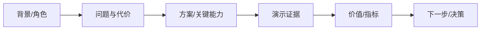

# {受众} 演示脚本

> **定位**：一次演示的完整脚本（故事线 + 逐步点击 + 数据 + 兜底 + Q&A）。  
> **落点**：`产品/{版本}/05-展示与材料/演示脚本-{受众}-{yyyyMMdd}.md`。  
> **纪律**：只演示当前项目真实能力；未实现/未验证不演；数字/截图/流程可回查。

## 1. 基本信息

| 项 | 值 |
| --- | --- |
| 受众 | `{老板/客户/用户/技术}` |
| 目标 | `{汇报/演示/培训/销售}` |
| 时长 | `{分钟}` |
| 成功标准 | `{观众理解/认可/下一步}` |
| 产品/版本 | `{…}` |
| PRD / 原型 / 构建 | `{路径/版本}` |
| 保密边界 | `{不演示/不披露}` |

## 2. 故事线与流程图

- 每个节点的证据：`{PRD/原型/构建/数据/客户反馈}`
- 关键信息（3～5 条）：`{…}`

## 3. 演示场景

> 每个场景一张表；路径详细到菜单 → 页面 → Tab → 控件/行；未实现能力不演。

### 场景 1：`{名称}`

| 项 | 内容 |
| --- | --- |
| 目标 | `{观众要看到什么}` |
| 入口 | `{菜单一级 → 二级 → 页面}` |
| 逐步路径 | `{1. 点击… 2. 输入… 3. 选择…}` |
| 数据 | `{真实/脱敏样本；seed/重置方式}` |
| 预期 | `{可观测结果}` |
| 兜底 | `{失败时切录屏/截图/原型}` |
| 时长 | `{分钟}` |

### 场景 2：`{名称}`

（同上）

## 4. Q&A 与异议

| 可能的异议 | 回应要点 | 证据 |
| --- | --- | --- |
| `{…}` | `{…}` | `{数据/文档/案例}` |

- 不知道的：记录，会后回填；不编。
- 对外承诺：只写已确认内容；未确认写“待评估”。

## 5. 项目对齐检查

- [ ] 每个演示点回指 PRD F/A/AC 或原型/构建
- [ ] 术语/数字/截图/流程与当前版本一致
- [ ] 未实现/未发布能力已标“不演示/后续”
- [ ] 真实客户数据已脱敏；演示环境隔离
- [ ] 录屏/截图兜底可用；账号/数据可重置

## 6. 彩排记录

| 日期 | 参与人 | 问题 | 修正 | 状态 |
| --- | --- | --- | --- | --- |
| `{…}` | `{…}` | `{…}` | `{…}` | `{待修/已修}` |
