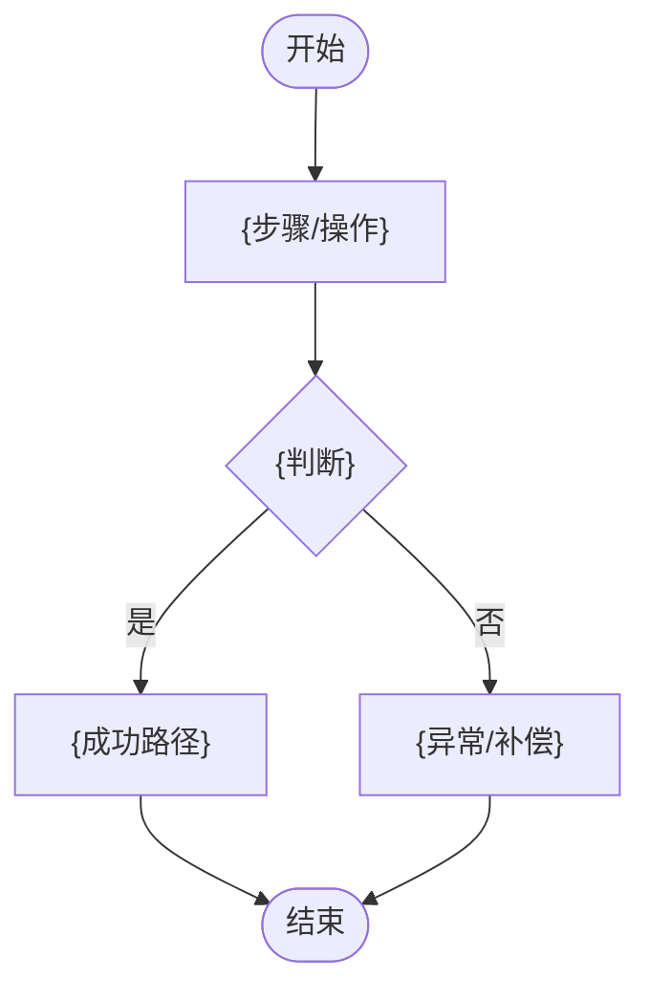
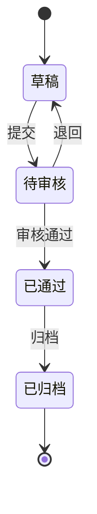

# {主题} 产品需求文档（PRD）

> **状态图例**：`[已确认]` 有来源/决策；`[建议]` 待评审；`[待确认]` 有责任人/期限。  
> **技术边界**：PRD 只写业务规则、NFR 目标与约束、验收；技术架构/技术栈/DB/API/部署归开发 `方案/ADR`。  
> **图**：主流程与状态机用 Mermaid；判断出线标“是/否”；异常路径可见。  
> **配套**：需求池 `{R-xx}`；原型 `{产品/{版本}/原型/}`；评审记录 `评审-{主题}-{yyyyMMdd}.md`。

## 0. 一页摘要

| 项 | 内容 |
| --- | --- |
| 背景 | `{为什么做（问题/机会）}` |
| 目标 | `{一句话目标}` |
| 成功指标 | `{北极星 + 1～2 辅助指标 + 观测窗口}` |
| 范围 | 做：`{…}` ｜ 不做：`{…}` |
| 关键依赖 | `{系统/团队/合规}` |
| 结论 | `{建议/待确认}` |

## 1. 背景与依据

| 依据 | 内容 | 来源 + 日期 |
| --- | --- | --- |
| 用户/客户 | `{…}` | `{访谈/工单/数据}` |
| 数据 | `{…}` | `{报表/口径/时间窗}` |
| 竞品/市场 | `{…}` | `{链接/日期}` |
| 业务/合规 | `{…}` | `{文件/条款}` |

> 无依据写「待验证 + 验证方式」；禁编数字/用户反馈。

## 2. 用户与场景

| 角色 | 谁 | 核心任务 | 频率 | 环境/设备 |
| --- | --- | --- | --- | --- |
| `{…}` | `{…}` | `{…}` | `{高/中/低}` | `{PC/手机/打印}` |

- 核心场景：`{谁在什么情况下做什么，期望什么结果}`
- 用户故事（按需）：作为 `{角色}`，我希望 `{动作}`，以便 `{价值}`。
- 术语与口径：`{术语=定义；来源}`

## 3. 范围与边界

- **本期做（MVP）**：`{…}`
- **本期不做**：`{…}`（原因）
- **暂缓/后续**：`{…}`
- **约束**：`{预算/时间/合规/现有系统}`

## 4. 功能需求（F-xx）

| ID | 功能 | 优先级 | 用户价值 | 规则/状态 | 权限/数据域 | 关联 AC |
| --- | --- | --- | --- | --- | --- | --- |
| F-01 | `{…}` | P0/P1/P2 | `{…}` | `{…}` | `{…}` | AC-01 |

> 每条 F 至少 1 条 AC；写不出 AC = 需求未定义完。

## 5. 业务流程图（Mermaid）

> 主流程 + 异常/补偿路径；判断出线标“是/否”；复杂流程可加子流程。

## 6. 状态机（Mermaid）

> 状态 × 事件；非法跃迁写拒绝表现；终态重入必须定义。

| 当前状态 | 事件 | 新状态 | 非法/拒绝表现 |
| --- | --- | --- | --- |
| `{…}` | `{…}` | `{…}` | `{…}` |

## 7. 权限矩阵

| 角色 | 查看 | 新建 | 编辑 | 删除 | 审批 | 数据域 |
| --- | --- | --- | --- | --- | --- | --- |
| `{…}` | 可/不可 | `{…}` | `{…}` | `{…}` | `{…}` | 本人/部门/全部 |

> 未定义权限标「待确认 + 责任人」；不默认“所有人可编辑”。

## 8. 数据与字段来源

> 业务字段/规则/口径；表结构/索引/迁移归开发。

| 字段 | 类型/必填 | 范围/默认 | 来源 | 校验/口径 | 说明 |
| --- | --- | --- | --- | --- | --- |
| `{…}` | `{…}` | `{…}` | `{用户输入/引用/计算}` | `{…}` | `{…}` |

- 计算与舍入：`{公式/精度/顺序}`
- 数据生命周期：`{创建/更新/删除/归档}`

## 9. 校验规则（R-xx）

| ID | 规则 | 比较/条件 | 失败表现 | 阻断/提示 | 来源 |
| --- | --- | --- | --- | --- | --- |
| R-01 | `{完整性/一致性/门槛}` | `{…}` | `{…}` | 阻断/提示 | `{…}` |

## 10. 异常与边界

- 空态/加载/失败重试：`{…}`
- 重复提交/并发/幂等：`{…}`
- 超长/特殊字符/Emoji：`{…}`
- 越权/未登录/会话过期：`{…}`
- 终态重入/撤销/回滚：`{…}`
- 数据量级/网络慢/断网：`{…}`

## 11. 非功能需求（N-xx）

> 只写目标与约束，不写技术实现；验收方式写清。

| ID | 质量要求 | 目标/约束 | 验收方式 | 待确认 |
| --- | --- | --- | --- | --- |
| N-01 | 性能 | `{响应/并发/量级}` | `{压测/采样}` | `{…}` |
| N-02 | 安全/隐私 | `{鉴权/脱敏/审计}` | `{检查/扫描}` | `{…}` |
| N-03 | 兼容 | `{端/浏览器}` | `{设备矩阵}` | `{…}` |
| N-04 | 可用性/恢复 | `{SLA/RTO/RPO}` | `{演练}` | `{…}` |

## 12. 埋点与成功指标

| 事件名 | 触发时机 | 关键属性 | 指标 | 观测窗口 |
| --- | --- | --- | --- | --- |
| `{event_name}` | `{…}` | `{…}` | `{…}` | 上线后 7/30 天 |

- 基线/目标：`{…}`；数据来源：`{…}`
- 无埋点写「不适用 + 原因」。

## 13. 验收场景（A-xx / AC-xx）

| 场景 ID | 场景 | Given | When | Then（可判定） | 关联 F/R |
| --- | --- | --- | --- | --- | --- |
| A-01 | `{…}` | `{前置}` | `{动作}` | `{观测结果}` | F-01/R-01 |

> 覆盖主路径、异常、边界、权限、状态；每条 AC 条件 + 动作 + 观测。

## 14. 追溯矩阵

| 需求 F | 规则 R | 验收场景 A | AC | 原型/页面 | 测试用例 | 发布版本 |
| --- | --- | --- | --- | --- | --- | --- |
| F-01 | R-01 | A-01 | AC-01 | `{原型路径}` | `{TC-ID/待补}` | `{版本}` |

> F→AC 断链、R→A 断链视为未完成；测试用例可后续补，但矩阵不能空。

## 15. 待确认与决策（Q/C）

| ID | 类型 | 问题/决策 | 影响 | 责任人 | 期限 | 状态 |
| --- | --- | --- | --- | --- | --- | --- |
| Q-01 | 待确认 | `{…}` | `{范围/成本/合规}` | `{…}` | `{…}` | 打开/关闭 |
| C-01 | 已确认 | `{…}` | `{…}` | `{…}` | `{…}` | 已确认 |

> 未标注的 TBD 不允许；关闭需给依据/来源。

## 16. 评审误区、依赖、风险、里程碑、变更

### 16.1 评审误区（本项目）

- `{如：关联齐全仍要查数据一致性；缺金额不能判一致；草稿≠正式；样单≠全量规则}`

### 16.2 依赖与风险

| 项 | 影响 | 应对 | 责任人 |
| --- | --- | --- | --- |
| `{依赖/风险}` | `{…}` | `{…}` | `{…}` |

### 16.3 里程碑

| 阶段 | 计划 | 实际 |
| --- | --- | --- |
| 设计/开发/提测/UAT/发布 | `{…}` | `{…}` |

### 16.4 变更记录

| 日期 | 版本 | 变更 | 变更单 | 影响 |
| --- | --- | --- | --- | --- |
| `{…}` | `{…}` | `{…}` | `{CR-…}` | `{…}` |
