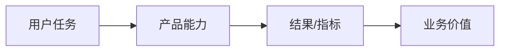

# {产品/版本} 一页纸与 Deck 大纲

> **定位**：对外介绍材料的内容骨架；先内容后视觉。  
> **落点**：`产品/{版本}/展示/一页纸-{产品}.md`、`展示/Deck大纲-{受众}.md`。  
> **纪律**：一页一个主张；数字/截图/流程与当前项目一致；未实现能力标“后续”。

## 一、一页纸

### 1. 一句话

> 为 `{谁}` 解决 `{什么问题}`，提供 `{什么方案}`，相比 `{替代方案}` 的优势是 `{…}`。

### 2. 问题与代价

- 现状：`{…}`
- 代价：`{时间/成本/风险}`
- 证据：`{来源+日期}`

### 3. 方案（3～4 个关键能力）

| 能力 | 解决什么 | 证据 |
| --- | --- | --- |
| `{…}` | `{…}` | `{PRD/原型/构建}` |

### 4. 价值与证据

- 指标：`{基线 → 目标}`；数据来源：`{…}`
- 案例/试点：`{客户/场景/结果}`（脱敏）

### 5. 下一步

- `{试用/演示/决策/联系}` + 负责人

## 二、Deck 大纲（10～12 页）

| # | 页面 | 结论（标题） | 证据/图 | 备注 |
| ---: | --- | --- | --- | --- |
| 1 | 封面 | `{产品/受众/日期}` | — | 版本号 |
| 2 | 背景与目标 | `{…}` | `{…}` | |
| 3 | 问题与代价 | `{…}` | `{数据/案例}` | |
| 4 | 方案总览 | `{…}` | Mermaid 流程图 | |
| 5 | 关键场景 1 | `{…}` | 截图/演示 | |
| 6 | 关键场景 2 | `{…}` | 截图/演示 | |
| 7 | 差异化 | `{…}` | 竞品对比（来源+日期） | |
| 8 | 价值/ROI | `{…}` | 数据/案例 | |
| 9 | 实施/集成/风险 | `{…}` | 业务视角 | 技术细节由开发补 |
| 10 | 路线图/下一步 | `{…}` | 时间线 | |
| 11 | 结论与请求 | `{决策/试用}` | — | |
| 12 | 附录 | 数据来源/术语 | — | |

### 视觉与可访问性

- 一套主色 + 中性色；字号阶 ≤4 级；对比度 ≥4.5:1。
- 图表先结论后图；坐标轴/单位/来源清楚。
- 截图用当前构建、脱敏、标注关键点；不拉伸/不模糊。
- 避免 AI 味：紫蓝渐变、玻璃拟态、图标堆砌、每页大标题。

### 项目对齐检查

- [ ] 数字/截图/流程回指 PRD/原型/构建/UAT
- [ ] 术语与产品一致
- [ ] 未实现能力标“后续”
- [ ] 真实客户信息脱敏
- [ ] 对外版本与 GTM/发布说明一致
